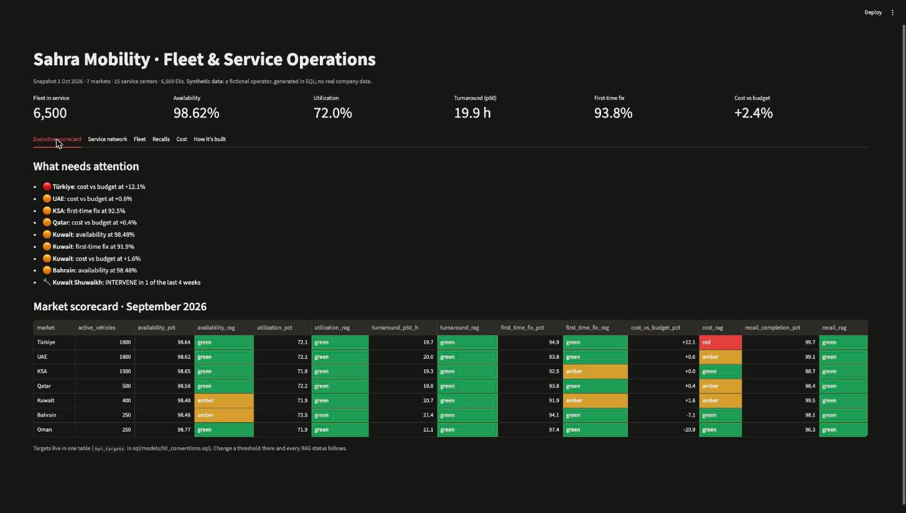
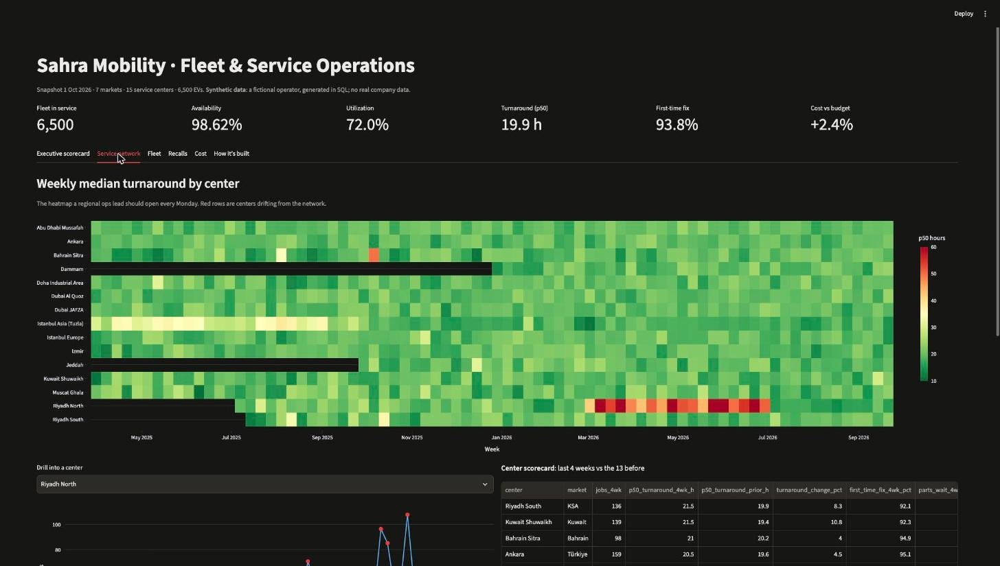
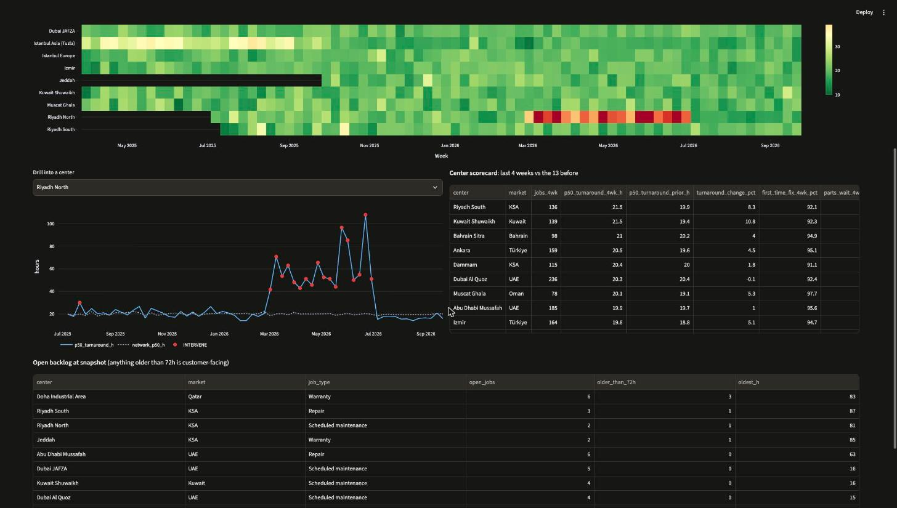
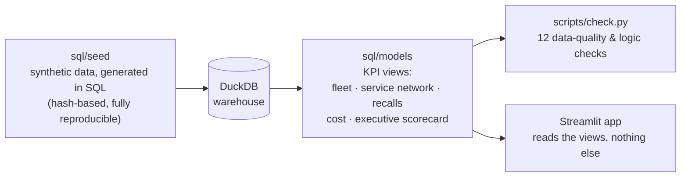

# Fleet & Service Operations KPI Dashboard

**The questions a regional operations lead has to answer every Monday, built as a SQL warehouse and a live dashboard.**

*Sahra Mobility* is a **fictional** EV fleet operator: 6,500 vehicles across the UAE, KSA, Qatar, Kuwait, Bahrain, Oman and Türkiye, served by 15 company-run service centers. Every row is generated in SQL. **No real company, employer or customer data is used.**



---

## The questions it answers

| Question | Where | KPI |
|---|---|---|
| Is the fleet on the road? | Executive, Fleet | Availability %, utilization % |
| Which service center needs me this week? | Service network | Weekly median turnaround vs network, **INTERVENE / WATCH / OK** flag |
| Is it getting better or worse? | Service network | Last 4 weeks vs the 13 before, per center |
| Are we fixing it right the first time? | Executive, Service network | First-time-fix %, parts-wait share |
| Will the regulator be satisfied on recalls? | Recalls | Completion % and cumulative curve per campaign and market |
| Are we on budget? | Cost | Fleet-paid service cost vs budget, cost per vehicle-month |
| What is customer-facing right now? | Service network | Open backlog aged over 72h |

Every KPI has a target and a **RAG status** driven from one table (`kpi_targets`). Change a threshold in one place and the whole dashboard follows.

## What the data shows

The synthetic network carries two operating stories. The dashboard is judged on whether it catches them, and `scripts/check.py` asserts that it does.

**1. Riyadh North: a crisis caught, and a recovery confirmed.** From March 2026 a parts shortage plus technician attrition pushes median turnaround from ~19h to 40–110h. The center is flagged **INTERVENE for 18 consecutive weeks**, KSA cost overshoots budget, and availability drops. After the July intervention, turnaround falls back below the network median (~17h) and stays there.



**2. Istanbul Asia: a turnaround.** It underperforms until October 2025: long queues, frequent repeat visits. After the turnaround, median turnaround falls from ~33h to ~17h (**about 48% faster**) and the repeat-visit rate drops.



## How it's built



- **SQL-first.** All logic lives in `sql/models/*.sql`: window functions for baselines and trailing averages, `FILTER` aggregates for period comparisons, and a `rag()` macro for status. The app only renders what the views return.
- **Reproducible.** Randomness is hash-based, so every build yields byte-identical data. The full warehouse builds in under a second.
- **Tested.** `scripts/check.py` checks referential and temporal integrity (no job before a vehicle entered service, no center serving before it opened, recall completions ≤ affected vehicles), and that both planted stories are detected.

| File | What it does |
|---|---|
| `sql/seed/00_generate.sql` | Markets, centers, vehicles, vehicle-months, service jobs, recall campaigns |
| `sql/models/00_conventions.sql` | Snapshot date, KPI targets, `rag()` macro |
| `sql/models/10_fleet_monthly.sql` | Availability and utilization by market and month |
| `sql/models/20_service_network.sql` | Weekly center KPIs with INTERVENE flags, center scorecard, aged backlog |
| `sql/models/30_recalls.sql` | Campaign completion and cumulative completion curves |
| `sql/models/40_cost.sql` | Fleet-paid cost vs budget, cost per vehicle-month |
| `sql/models/90_exec_scorecard.sql` | One row per market: every KPI, its RAG, its trend |

## Run it

```bash
python -m venv .venv && source .venv/bin/activate
pip install -r requirements.txt
make build     # generate data + build KPI views  (data/fleet.duckdb)
make check     # 12 data-quality and logic checks
make app       # dashboard on http://localhost:8501
```

## KPI definitions

| KPI | Definition |
|---|---|
| Availability % | 1 − workshop vehicle-hours ÷ vehicle-hours in service |
| Utilization % | Active hours ÷ (days in service × 16 planned operating hours) |
| Turnaround (p50) | Median hours from job open to vehicle released (queue + labour + parts wait) |
| First-time fix % | Share of jobs with no repeat visit for the same issue |
| INTERVENE | A complete week where a center's median turnaround exceeds 1.5× the network median or 1.5× its own trailing 4-week level |
| Cost vs budget % | Fleet-paid service cost ÷ (vehicle-months × budget per vehicle-month) − 1. Warranty and recall work is OEM-paid and excluded |
| Recall completion % | Affected vehicles with a closed recall job ÷ affected vehicles, for campaigns launched at least 8 weeks earlier |

---

Built by [Mohammad Alahmad](https://linkedin.com/in/pemalahmad) with Claude Code. The structure mirrors how I ran operations analytics for a multi-market EV network; the data and the company are invented.
