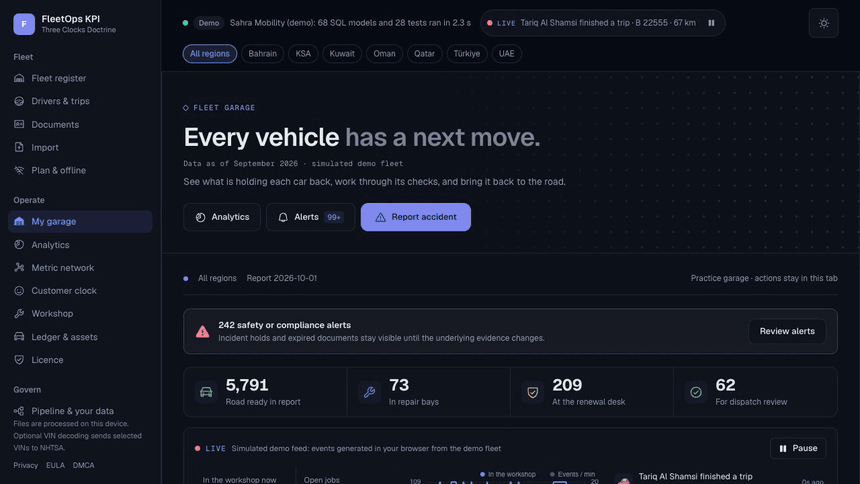
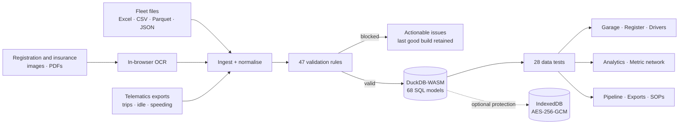
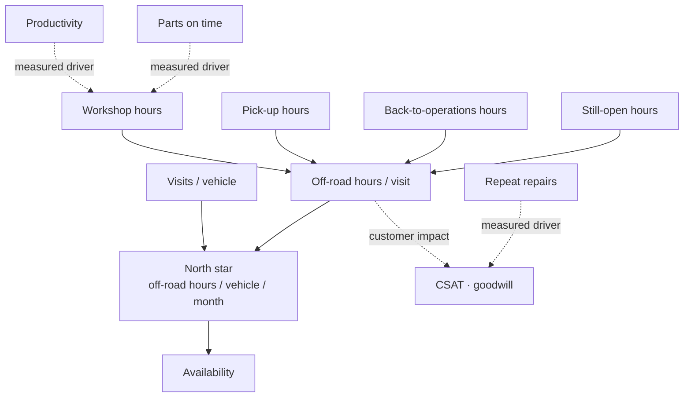

<div align="center">

# FleetOps KPI

**A local-first fleet operations cockpit, metric network, and tested analytics warehouse.**

[](https://github.com/Pemalahmad/FleetOps-KPI-Dashboard/actions/workflows/ci.yml)
[](https://github.com/Pemalahmad/FleetOps-KPI-Dashboard/actions/workflows/codeql.yml)
[](https://github.com/Pemalahmad/FleetOps-KPI-Dashboard/actions/workflows/security-audit.yml)
[](https://securityscorecards.dev/viewer/?uri=github.com/Pemalahmad/FleetOps-KPI-Dashboard)
[](LICENSE.md)

[Open dashboard](https://pemalahmad.github.io/FleetOps-KPI-Dashboard/) · [Try your data](#try-it-in-30-seconds) · [Run locally](#run-locally) · [Read the docs](#documentation)


</div>

FleetOps KPI turns Excel, CSV, Parquet, JSON, and document scans into a device-local fleet workspace. The browser runs the same DuckDB pipeline used by the Python CLI: **68 SQL models, 47 validation rules, and 28 data tests**. There is no application server and fleet data is not uploaded.

The included Sahra Mobility demo is synthetic: 6,500 vehicles, 15 workshops, 7 markets, and 18 months of operational history. It is large enough to exercise the full pipeline without presenting fictional results as industry benchmarks.


## What it answers

| Operational question | FleetOps answer |
|---|---|
| **Can this vehicle legally and safely drive?** | Registration, insurance, licence class, preventive maintenance, recalls, repair gates, and source freshness resolve to one next action. |
| **Where is fleet capacity being lost?** | A visual garage and the north star—off-road hours per vehicle per month—connect queue state to availability. |
| **Why did the KPI move?** | Exact identities, month-on-month decomposition, measured drivers, confidence intervals, and what-if propagation expose the path. |
| **Can the number be trusted?** | Every dashboard value traces through the work tree to its source, validation result, SQL model, and data test. |

## Product tour

| Visual garage | Metric network |
|---|---|
|  |  |
| Vehicles appear in their registered colour and body style. Open one to inspect its documents, repair milestones, release gates, owner, and target return date. | Select any metric to inspect its definition, live identity, change decomposition, regression evidence, and downstream impact. |

The rest of the workspace covers the fleet register, drivers and trips, document OCR, import mapping, customer clock, workshop performance, ledger and assets, compliance, SQL pipeline, operating doctrine, and system design.

## Try it in 30 seconds

1. [Open the dashboard](https://pemalahmad.github.io/FleetOps-KPI-Dashboard/).
2. Download [`samples/fleet-vehicles.xlsx`](samples/fleet-vehicles.xlsx) and drop it on **Import**.
3. Download [`samples/registration-card-sample.png`](samples/registration-card-sample.png) and drop it on **Documents**.
4. Review the repaired record in **Fleet register** and its effect on compliance.

The sample deliberately includes an expired registration, an insurance renewal, a broken VIN, and a missing VIN so the import and evidence workflow can be inspected end to end.

## How it works



The browser is the application backend. Next.js ships a static interface, DuckDB-WASM executes the analytical warehouse, and IndexedDB holds the optional encrypted workspace. The only external data service is NHTSA's VIN decoder, called only after the user requests it and protected by a rate limiter and circuit breaker.

### The metric graph



Solid links are exact identities asserted by SQL tests. Dashed links are measured relationships with β, standard error, t, p, 95% confidence interval, R², adjusted R², and F statistics. What-if changes propagate only through drivers significant at `p < 0.05`, then every identity is recalculated exactly.

## Run locally

Prerequisites: **Python 3.11+** and **Node.js 22**.

```bash
git clone https://github.com/Pemalahmad/FleetOps-KPI-Dashboard.git
cd FleetOps-KPI-Dashboard

python3 -m venv .venv
source .venv/bin/activate
python -m pip install -e .

fleetkpi web-export --out web/public
cd web
npm ci
npm run dev
```

Open `http://localhost:3000`. The export command packages the SQL engine and synthetic demo fleet for the browser; it does not start a data service.

### Run the warehouse from the CLI

```bash
fleetkpi demo my-fleet
cd my-fleet
fleetkpi validate
fleetkpi build
fleetkpi serve
```

For an empty project, run `fleetkpi init my-fleet`. It creates `fleet.yml`, input templates, and the generated data contract.

## Bring your own fleet

Four tables are required: `sites`, `vehicles`, `work_orders`, and `usage`. Optional inputs add energy, feedback, parts, fines, documents, recalls, budgets, drivers, trips, warranties, add-ons, and service contacts.

- Common exports from Fleetio, Samsara, Motive, Geotab, Verizon Connect, and Webfleet are recognised by column synonyms.
- Powertrains, work-order types, date formats, and numeric formats are normalised before validation.
- Unknown columns can be mapped once in `fleet.yml`.
- Missing optional tables hide their dependent sections instead of breaking the build.

See the generated [data contract](docs/DATA_CONTRACT.md) for every table, field, synonym, and constraint.

## Engineering quality

| Layer | Checkable guarantee |
|---|---|
| **Warehouse** | Dependency-sorted SQL models, atomic publication, retained last-good build, validation issues with offending row identifiers, and lineage logs. |
| **Browser** | Static export, strict Content Security Policy, no inline-script escape hatch, offline package, responsive light/dark UI, and reduced-motion support. |
| **Design** | One tile system from [design principles](docs/DESIGN_PRINCIPLES.md): bundled Geist type (no font host), every text colour at WCAG AA 4.5:1 in light and dark, status in words as well as colour, an "as of" stamp on every data page, and loading, empty and error states that never hang. |
| **Untrusted input** | Property-based parser tests, spreadsheet formula neutralisation, hostile workbook rendering tests, and authenticated encryption with tamper detection. |
| **Statistics** | Implemented from first principles and tested against R, SciPy, and statsmodels reference values. |
| **CI** | Python 3.11 and 3.13, web lint/type/unit/build, Playwright security flows, dependency audits, CodeQL, OpenSSF Scorecard, and a Docker demo build. |

Run the same core checks locally:

```bash
pytest

cd web
npm run lint
npm run typecheck
npm test
npm run build
npm run test:e2e
```

The browser test suite covers strict CSP, injected-script refusal, hostile workbook content, clickjacking protection, encrypted storage, wrong-passphrase rejection, OCR policy, and mobile overflow.

## Repository map

```text
FleetOps-KPI-Dashboard/
├── fleetkpi/              Python package, CLI, contracts, pipeline, and SQL
│   ├── sql/models/        staging → intermediate → marts
│   ├── sql/validation/    source-data rules; zero rows means pass
│   ├── sql/tests/         model grain, range, reconciliation, and identities
│   └── sops/              operating procedures and triggers
├── web/                   Next.js dashboard and DuckDB-WASM runtime
│   ├── src/app/           product pages
│   ├── src/components/    interface, charts, garage, and visual systems
│   ├── src/lib/           engine, statistics, metrics, storage, and security
│   └── e2e/               production-browser security and workflow tests
├── docs/                  architecture, doctrine, contracts, catalog, and media
├── samples/               import-ready workbook and registration-card sample
├── tests/                 Python integration and pipeline tests
└── .github/workflows/     CI, Pages, release, CodeQL, and security audits
```

## Documentation

| Document | Use it for |
|---|---|
| [Fleet software guide](docs/FLEET_SOFTWARE.md) | Owner workflow, supported exports, and product scope |
| [Garage workflow](docs/GARAGE.md) | Stages, gates, alerts, evidence, and handovers |
| [Three Clocks Doctrine](docs/DOCTRINE.md) | Operating model behind the KPI system |
| [System design](docs/SYSTEM_DESIGN.md) | Architecture decisions and hosted-system comparisons |
| [Design principles](docs/DESIGN_PRINCIPLES.md) | Tiles, type, colour, motion, data states, and the UI "Done when" checklist |
| [SQL catalog](docs/SQL_CATALOG.md) | Every model, dependency, validation rule, and test |
| [Data contract](docs/DATA_CONTRACT.md) | Input schemas, accepted synonyms, and constraints |
| [Security](SECURITY.md) | Threat model, reporting, and supported versions |
| [Contributing](CONTRIBUTING.md) | Development workflow and contribution standards |
| [Changelog](CHANGELOG.md) | User-visible changes by release |

## Scope

- FleetOps imports file-based telematics summaries; it is not a GPS ingestion service.
- Live demo events are simulated and labelled as such.
- Notifications are generated from imported evidence and in-app reports; there is no automatic accident detection.
- The demo company, people, contacts, and results are fictional.

## Licence

[Functional Source License 1.1 with an MIT future licence](LICENSE.md). You may use, modify, and run FleetOps for your own fleet, research, teaching, or client work. Each release becomes MIT two years after publication; versions through `0.5.0` remain MIT.

---

Built by [Mohammad Alahmad](https://linkedin.com/in/pemalahmad). The operating model reflects multi-market fleet analytics experience; all demo data is synthetic.
