<div align="center">

# FleetOps KPI

**Review vehicle holds, work the damage case, and record who cleared the vehicle for return to service.**

[](https://github.com/Pemalahmad/FleetOps-KPI-Dashboard/actions/workflows/ci.yml)
[](https://github.com/Pemalahmad/FleetOps-KPI-Dashboard/actions/workflows/codeql.yml)
[](https://github.com/Pemalahmad/FleetOps-KPI-Dashboard/actions/workflows/security-audit.yml)
[](https://securityscorecards.dev/viewer/?uri=github.com/Pemalahmad/FleetOps-KPI-Dashboard)
[](LICENSE.md)

[Open dashboard](https://pemalahmad.github.io/FleetOps-KPI-Dashboard/) · [Practice a damage case](#practice-the-release-workflow) · [Run locally](#run-locally) · [Read the docs](#documentation)

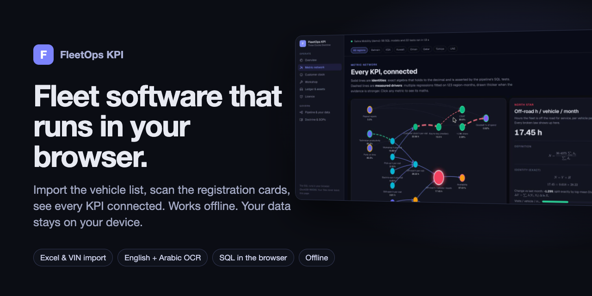

</div>

FleetOps KPI turns Excel, CSV, Parquet, JSON, and document scans into a device-local fleet workspace. The browser runs the same DuckDB pipeline used by the Python CLI: **71 SQL models, 47 validation rules, and 30 data tests**. Fleet files, OCR and release checks stay in the browser. Configured deployments can opt into a signed-in team register for EHS and compliance cases.

The included Sahra Mobility demo is synthetic: 6,500 vehicles, 15 workshops, 7 markets, and 18 months of operational history. It is large enough to exercise the full pipeline without presenting fictional results as industry benchmarks.

## Practice the release workflow

1. Use [the sample fleet import](#try-it-in-30-seconds) to see how missing or expired evidence lands in the vehicle queue. Return to the built-in demo to practice a full release.
2. In **Daily command**, select **Practice a damage case**. Record the initial hold on a synthetic UAE vehicle, then assign or update the case owner and work the SOP-09 steps.
3. Record the deadline sources, evidence, approval, repairs and quality review. Use the **Overdue damage** or stage filter to find the case again.
4. Complete the current source checks and the named reviewer’s handover. Download the release record or the shift handoff directly from the browser.

The first pilot is designed for a Dubai rental depot with 20–100 vehicles, using its existing fleet and workshop exports. [Four-week pilot and scorecard](docs/CASE_STUDY.md#four-week-depot-pilot)

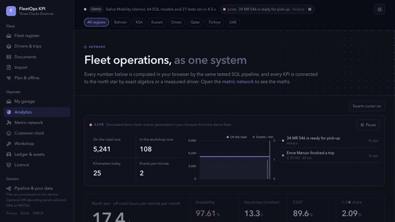

## Watch it in two minutes

[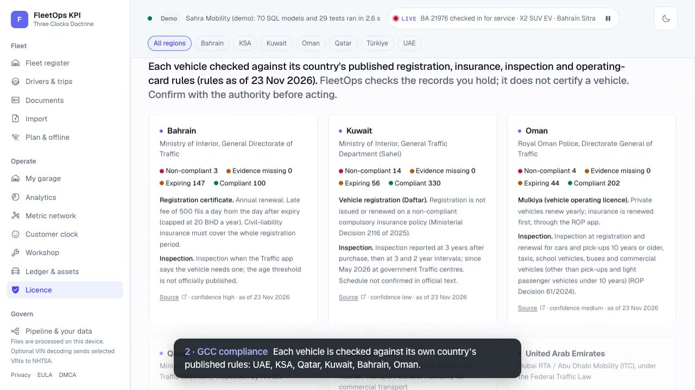](docs/walkthrough.mp4)

**[Play the walkthrough](docs/walkthrough.mp4)** (2 min, captioned) · **[Read the case study](docs/CASE_STUDY.md)**: what FleetOps finds in a 6,500-vehicle fleet across the GCC and Türkiye, and what a real pilot would measure.

## What it answers

| Operational question | FleetOps answer |
|---|---|
| **What needs action today?** | The Daily command board puts critical holds, overdue damage deadlines, renewals, dispatch review, handovers, owners and direct vehicle actions in one operating surface. |
| **Can this vehicle legally and safely drive?** | Registration, insurance, licence class, preventive maintenance, recalls, repair gates, and source freshness resolve to one next action. |
| **Where is each car in the workshop, and what was done to it?** | The Service board tracks every repair order from Scheduled to Delivered with a technician on each stage: check-in condition, tyres and odometer in and out, issue, diagnosis and work done, warranty, customer-pay, recall or retrofit lines with claim numbers, estimated vs logged hours, parts, comments, invoices and each vehicle's full service history ([how it works](docs/SERVICE_BOARD.md)). |
| **Which dispatch rule should we run?** | The Dispatch lab runs the same simulated day through shortest-distance, highest-margin, least-deadhead and earliest-deadline dispatch for vans, buses or trucks, and compares on-time delivery, empty-mile ratio, driver utilisation, turnaround and margin with 95% confidence intervals ([model](docs/DISPATCH_LAB.md)). |
| **Is each vehicle legal in its GCC country?** | Every active vehicle is checked against the published registration, insurance, inspection and operating-card rules of the UAE, Saudi Arabia, Qatar, Kuwait, Bahrain or Oman, with the reason, the authority and a dated source. A check of your records, never a certification ([rules](docs/GCC_COMPLIANCE.md)). |
| **Who owns an overdue GCC inspection or renewal?** | Daily Command records the case owner, manager and follow-up. A confirmed upload that passes the applicable check closes the case and preserves the evidence. |
| **How do we manage ISO certification?** | The shared tracker records certificate scope, verification, audit dates and findings. Renewal reminders and overdue escalations go to the team inbox. [Full fleet SOP](fleetkpi/sops/SOP-10-fleet-iso-certification.md) |
| **Can managers share a case and see their notifications on another device?** | Team cases gives invited managers a shared EHS and compliance register, assignments, a case history and overdue notifications. [Team cases setup](docs/TEAM_CASES.md) |
| **How are safety and environmental incidents handled?** | The EHS workspace provides standards, an incident SOP, severity-based escalation, an assigned case owner and independent closure review. |
| **What happens when a vehicle is damaged?** | A damage case holds the vehicle off the road and walks it through severity, safety, evidence, notifications and deadlines, estimate, authorization, repair and quality check, with overdue alerts and an audit trail, before handover is allowed (SOP-09). |
| **Should we keep this vehicle or replace it, and with an EV or a petrol car?** | The Replace or keep planner prices every vehicle three ways over the same horizon: keep it, replace it now with a new petrol vehicle, or with an electric one. It shows cost per km to date and projected, the break-even year and one recommendation with its reason, plus the fleet's capital needed and saving. Inputs the records lack are editable assumptions, each marked with its source, and every formula is on the page. |
| **Where is fleet capacity being lost?** | A visual garage and the north star—off-road hours per vehicle per month—connect queue state to availability. |
| **Why did the KPI move?** | Exact identities, month-on-month decomposition, measured drivers, confidence intervals, and what-if propagation expose the path. |
| **Can the number be trusted?** | Every dashboard value traces through the work tree to its source, validation result, SQL model, and data test. |

## Product tour

| Daily command and visual garage | Metric network |
|---|---|
|  |  |
| Vehicles appear in their registered colour and body style. Open one to inspect its documents, repair milestones, release gates, owner, and target return date. | Select any metric to inspect its definition, live identity, change decomposition, regression evidence, and downstream impact. |

**GCC compliance escalations.** Track overdue inspections and renewals through owner assignment, manager follow-up and verified document upload.

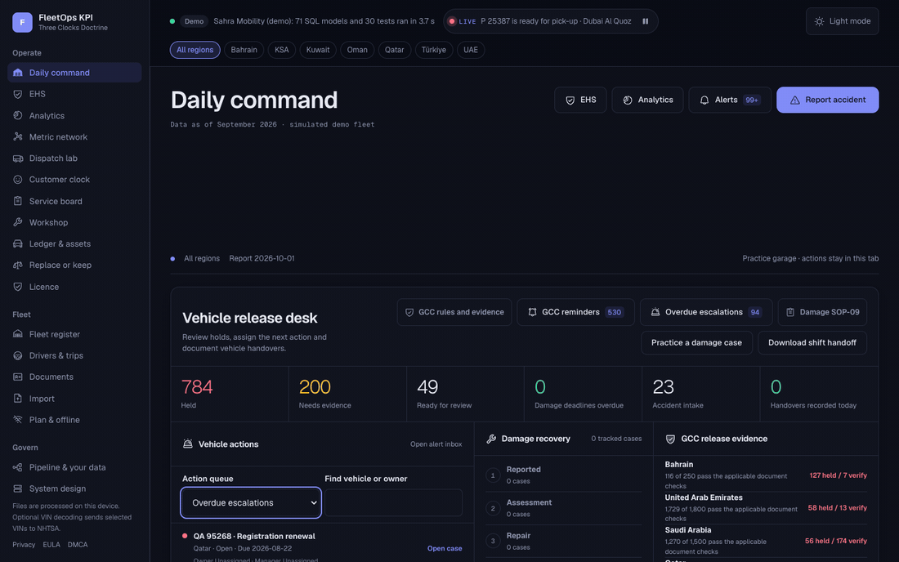

**ISO certification.** Review certificate status and due dates, schedule audits, and track findings until an independent reviewer verifies closure.

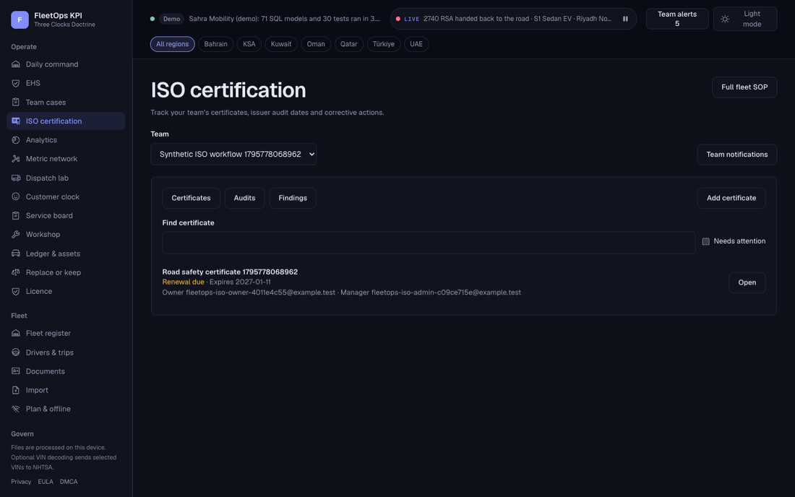

**Team cases.** The shared register gives signed-in managers a case owner, follow-up, history and a personal inbox.

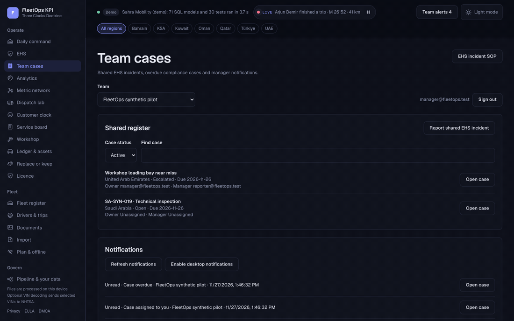

**Environment, health and safety.** Report hazards and incidents, track follow-up and use the SOP and standards from the EHS workspace.

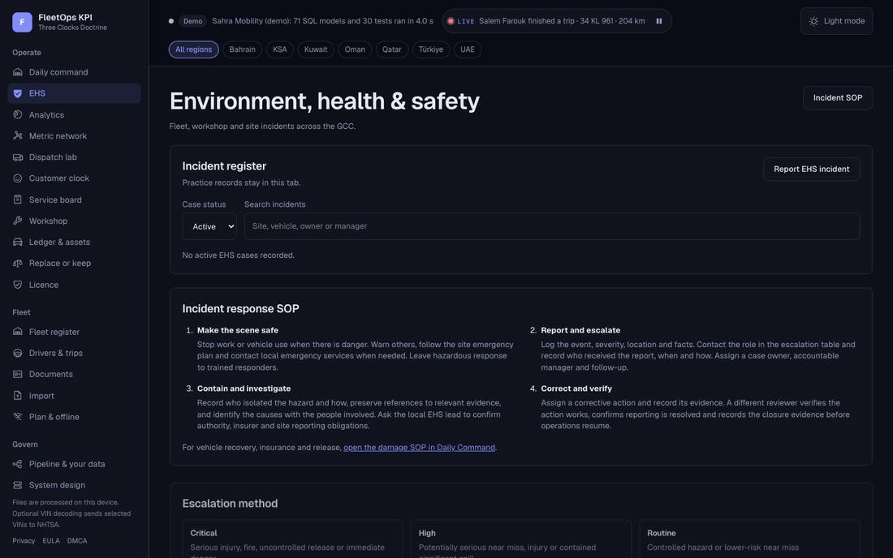

**Service board.** Repair orders from booking to delivery, with the check-in, tyres, work lines, hours, parts and invoice on one job sheet:

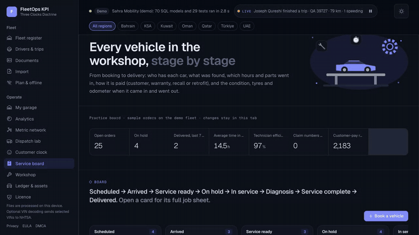

**Dispatch lab.** The same simulated day run through four dispatch rules, for vans, buses or trucks, with 95% confidence intervals:

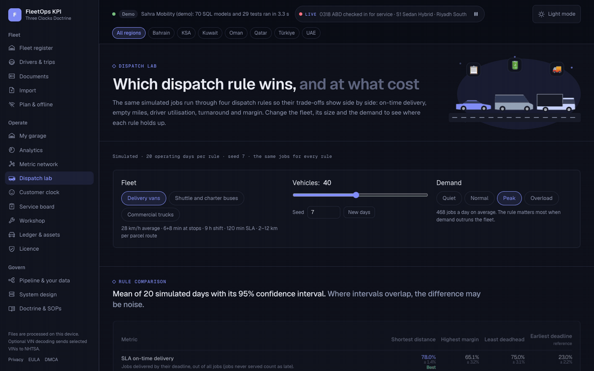

**Replace or keep.** Cost of ownership per vehicle from its own usage, energy and workshop records, priced against a new petrol vehicle and a new EV, with the break-even year, the reason for each recommendation and every assumption in view:

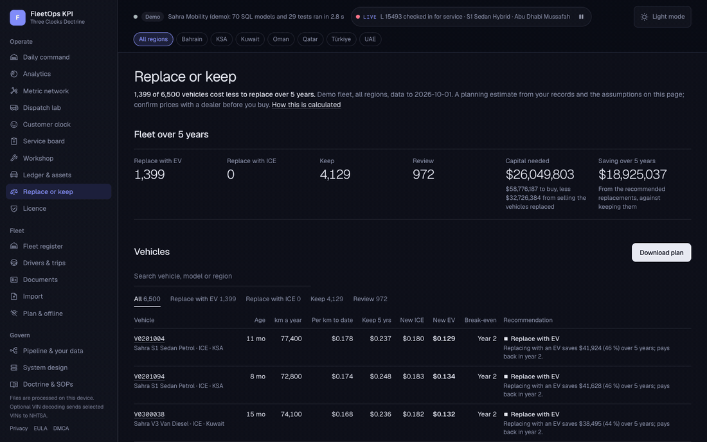

The rest of the workspace covers the fleet register, drivers and trips, document OCR, import mapping, customer clock, workshop performance, ledger and assets, compliance, SQL pipeline, operating doctrine, and system design.

## Try it in 30 seconds

1. [Open the dashboard](https://pemalahmad.github.io/FleetOps-KPI-Dashboard/).
2. Download [`samples/fleet-vehicles.xlsx`](samples/fleet-vehicles.xlsx) and drop it on **Import**.
3. Download [`samples/registration-card-sample.png`](samples/registration-card-sample.png) and drop it on **Documents**.
4. Review the repaired record in **Fleet register** and its effect on compliance.

The sample deliberately includes an expired registration, an insurance renewal, a broken VIN, and a missing VIN so the import and evidence workflow can be inspected end to end.

## How it works

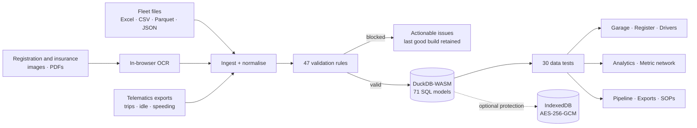

The browser is the application backend. Next.js ships a static interface, DuckDB-WASM executes the analytical warehouse, and IndexedDB holds the optional encrypted workspace. The only external data service is NHTSA's VIN decoder, called only after the user requests it and protected by a rate limiter and circuit breaker.

### The metric graph

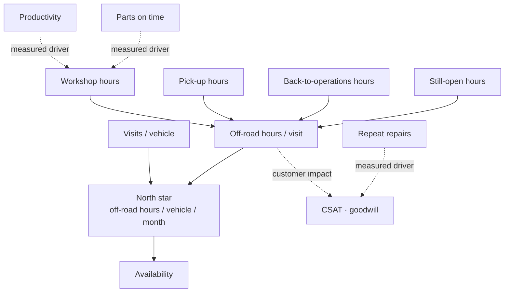

Solid links are exact identities asserted by SQL tests. Dashed links are measured relationships with β, standard error, t, p, 95% confidence interval, R², adjusted R², and F statistics. What-if changes propagate only through drivers significant at `p < 0.05`, then every identity is recalculated exactly.

## Run locally

Prerequisites: **Python 3.11+** and **Node.js 22**.

```bash
git clone https://github.com/Pemalahmad/FleetOps-KPI-Dashboard.git
cd FleetOps-KPI-Dashboard

python3 -m venv .venv
source .venv/bin/activate
python -m pip install -e .

fleetkpi web-export --out web/public
cd web
npm ci
npm run dev
```

Open `http://localhost:3000`. The export command packages the SQL engine and synthetic demo fleet for the browser; it does not start a data service.

### Run the warehouse from the CLI

```bash
fleetkpi demo my-fleet
cd my-fleet
fleetkpi validate
fleetkpi build
fleetkpi serve
```

For an empty project, run `fleetkpi init my-fleet`. It creates `fleet.yml`, input templates, and the generated data contract.

## Bring your own fleet

Four tables are required: `sites`, `vehicles`, `work_orders`, and `usage`. Optional inputs add energy, feedback, parts, fines, documents, recalls, budgets, drivers, trips, warranties, add-ons, and service contacts.

- Common exports from Fleetio, Samsara, Motive, Geotab, Verizon Connect, and Webfleet are recognised by column synonyms.
- Powertrains, work-order types, date formats, and numeric formats are normalised before validation.
- Unknown columns can be mapped once in `fleet.yml`.
- Missing optional tables hide their dependent sections instead of breaking the build.

See the generated [data contract](docs/DATA_CONTRACT.md) for every table, field, synonym, and constraint.

## Engineering quality

| Layer | Checkable guarantee |
|---|---|
| **Warehouse** | Dependency-sorted SQL models, atomic publication, retained last-good build, validation issues with offending row identifiers, and lineage logs. |
| **Browser** | Static export, strict Content Security Policy, no inline-script escape hatch, offline package, responsive light/dark UI, and reduced-motion support. |
| **Design** | One tile system from [design principles](docs/DESIGN_PRINCIPLES.md): bundled Geist type (no font host), every text colour at WCAG AA 4.5:1 in light and dark, status in words as well as colour, an "as of" stamp on every data page, and loading, empty and error states that never hang. |
| **Untrusted input** | Property-based parser tests, spreadsheet formula neutralisation, hostile workbook rendering tests, and authenticated encryption with tamper detection. |
| **Statistics** | Implemented from first principles and tested against R, SciPy, and statsmodels reference values. |
| **CI** | Python 3.11 and 3.13, web lint/type/unit/build, Playwright security flows, dependency audits, CodeQL, OpenSSF Scorecard, and a Docker demo build. |
| **Shipping** | `npm run ship-check` checks the changelog entry, README links, GIF recording scenes, SQL counts and commit trailers, and prints one pass/fail line each; repeated workflows are linted step-by-step instructions in [`.agents/skills/`](.agents/skills/). |

Run the same core checks locally:

```bash
pytest

cd web
npm run lint
npm run typecheck
npm test
npm run build
npm run test:e2e
```

The browser test suite covers strict CSP, injected-script refusal, hostile workbook content, clickjacking protection, encrypted storage, wrong-passphrase rejection, OCR policy, and mobile overflow.

## Repository map

```text
FleetOps-KPI-Dashboard/
├── fleetkpi/              Python package, CLI, contracts, pipeline, and SQL
│   ├── sql/models/        staging → intermediate → marts
│   ├── sql/validation/    source-data rules; zero rows means pass
│   ├── sql/tests/         model grain, range, reconciliation, and identities
│   └── sops/              operating procedures and triggers
├── web/                   Next.js dashboard and DuckDB-WASM runtime
│   ├── src/app/           product pages
│   ├── src/components/    interface, charts, garage, and visual systems
│   ├── src/lib/           engine, statistics, metrics, storage, and security
│   └── e2e/               production-browser security and workflow tests
├── docs/                  architecture, doctrine, contracts, catalog, and media
├── samples/               import-ready workbook and registration-card sample
├── tests/                 Python integration and pipeline tests
└── .github/workflows/     CI, Pages, release, CodeQL, and security audits
```

## Documentation

| Document | Use it for |
|---|---|
| [Fleet software guide](docs/FLEET_SOFTWARE.md) | Owner workflow, supported exports, and product scope |
| [Garage workflow](docs/GARAGE.md) | Stages, gates, alerts, evidence, and handovers |
| [Service board](docs/SERVICE_BOARD.md) | Repair-order stages, the checks each move needs, pay types, invoices and vehicle history |
| [Dispatch lab](docs/DISPATCH_LAB.md) | The dispatch simulation: model, rules, metric definitions and limits |
| [Case study](docs/CASE_STUDY.md) | The demo fleet's findings, the build choices behind them, and a pilot plan |
| [GCC compliance rules](docs/GCC_COMPLIANCE.md) | The six countries' rules, sources, confidence and what is not confirmed |
| [Three Clocks Doctrine](docs/DOCTRINE.md) | Operating model behind the KPI system |
| [System design](docs/SYSTEM_DESIGN.md) | Architecture decisions and hosted-system comparisons |
| [Design principles](docs/DESIGN_PRINCIPLES.md) | Tiles, type, colour, motion, data states, and the UI "Done when" checklist |
| [SQL catalog](docs/SQL_CATALOG.md) | Every model, dependency, validation rule, and test |
| [Data contract](docs/DATA_CONTRACT.md) | Input schemas, accepted synonyms, and constraints |
| [Security](SECURITY.md) | Threat model, reporting, and supported versions |
| [Contributing](CONTRIBUTING.md) | Development workflow and contribution standards |
| [Changelog](CHANGELOG.md) | User-visible changes by release |

## Scope

- FleetOps imports file-based telematics summaries; it is not a GPS ingestion service.
- Live demo events are simulated and labelled as such.
- Notifications are generated from imported evidence and in-app reports; there is no automatic accident detection.
- The demo company, people, contacts, and results are fictional.

## Licence

[Functional Source License 1.1 with an MIT future licence](LICENSE.md). You may use, modify, and run FleetOps for your own fleet, research, teaching, or client work. Each release becomes MIT two years after publication; versions through `0.5.0` remain MIT.

---

Built by [Mohammad Alahmad](https://linkedin.com/in/pemalahmad). The operating model reflects multi-market fleet analytics experience; all demo data is synthetic.
