# FleetOps KPI: fleet operations as one system of equations

**A visual fleet garage, with every KPI connected in one network: exact identities that hold to the decimal, and measured drivers with standard errors, p-values and confidence intervals. The tested SQL pipeline runs in your browser, on the demo fleet or on your own files.**

[](https://github.com/Pemalahmad/FleetOps-KPI-Dashboard/actions/workflows/ci.yml)
[](https://securityscorecards.dev/viewer/?uri=github.com/Pemalahmad/FleetOps-KPI-Dashboard)

-FFF000?logo=duckdb&logoColor=black)


[](LICENSE.md)

### ▶ [Open the live dashboard](https://pemalahmad.github.io/FleetOps-KPI-Dashboard/)

No install, no server, no upload: DuckDB-WASM runs the 64 SQL models and 27 tests on a 6,500-vehicle demo fleet in about 2 seconds, in the page.

**For fleet owners.** Import your vehicle list from Excel (VINs, plates, trims, configurations; exports from Fleetio, Samsara, Motive, Geotab or Verizon Connect are recognised), photograph your registration cards and insurance policies, and get a fleet register with one next action per vehicle. VINs are validated and decoded, documents are read in English and Arabic and matched by VIN or plate, and their expiries drive compliance. Your data stays in your browser. See [FleetOps as fleet software](docs/FLEET_SOFTWARE.md).

**Works offline.** Install it as an app from the browser, or download the [offline package](https://github.com/Pemalahmad/FleetOps-KPI-Dashboard/releases/latest) (Mac, Windows, Linux launchers; runs on `127.0.0.1` only). Renewal reminders export to your calendar; the register exports to Excel. An optional passphrase encrypts everything the browser keeps (AES-256). Every feature is free during early access. [Security](SECURITY.md) · [Privacy Policy](PRIVACY.md) · [EULA](EULA.md) · [DMCA](DMCA.md) · [Changelog](CHANGELOG.md) · [Contributing](CONTRIBUTING.md) · [Agents](AGENTS.md).

**Try it in 30 seconds.** Download [`samples/fleet-vehicles.xlsx`](samples/fleet-vehicles.xlsx) and drop it on
**Import**, then drop [`samples/registration-card-sample.png`](samples/registration-card-sample.png) on **Documents**.
The sample fleet has an expired registration, an insurance renewal due, a broken VIN and a missing VIN; the scanned
card renews the expired one.

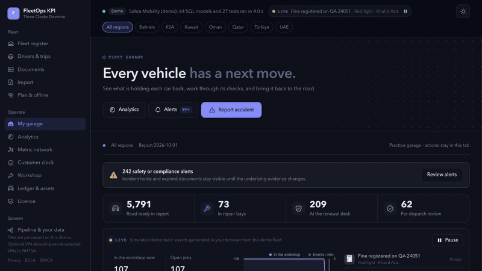


## The visual garage

The home page is a 3D garage floor with six work zones: Road ready, Repair bays, Renewal desk, Accident intake, Dispatch review and Safety checks. Each car is drawn in its registered colour and body style (sedan, hatchback, SUV, pickup, van, minibus, cab-over box truck or tractor unit); accident holds flash, repair bays lift the car. Drag to turn the floor, zoom in, hover a car for its stage and gates, click it to open it. The zone list below the scene is the keyboard and screen-reader route to the same vehicles.

Open a car for recorded repair milestones, registration and insurance stages, source blockers, a release checklist, a named owner and a target return date.

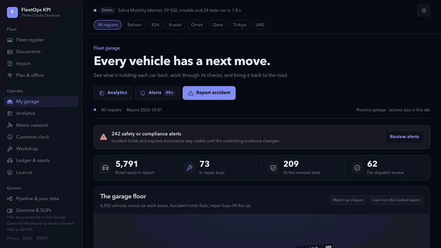

Report an accident to hold the vehicle and track assessment, repair, quality checks and dispatch review. The alert inbox includes paging, type filters and read status. A crew rank with an XP bar, badges and recovery missions with progress reward completed work; points cannot bypass an expired document, unresolved repair or evidence gap.

**The fleet register** shows every vehicle's identity, licence and next action, one bar per model split by trim, and the car shape the garage draws for each model. The shape is guessed from the model name (Hilux → pickup, Hiace → van, Land Cruiser → SUV) and the owner can change it.

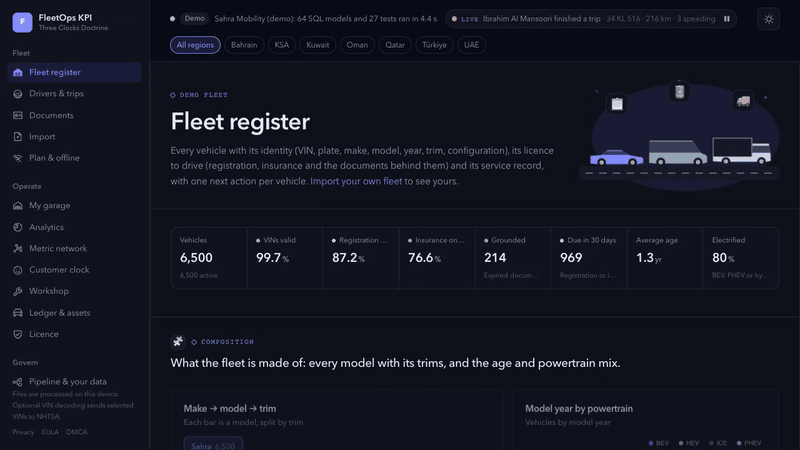

**Analytics** opens with the north star (off-road hours per vehicle per month) and eight headline KPIs, then 44 indicators in seven groups (fleet and uptime, compliance, maintenance and health, drivers and trips, workshop, customer clock, cost), each with its target, trend and change on last month, and a scorecard of every region against every target. A value turns amber or red only when it is off target.


Garage actions for your fleet use the same device-local Workspace and optional passphrase encryption. Demo actions are isolated practice in tab memory. Notifications update from imported evidence and in-app incident reports; there is no automatic accident detection or external alert service. Current handovers recheck document dates, source freshness, vehicle-level usage coverage and all release requirements. See [garage workflow](docs/GARAGE.md).

## The metric network

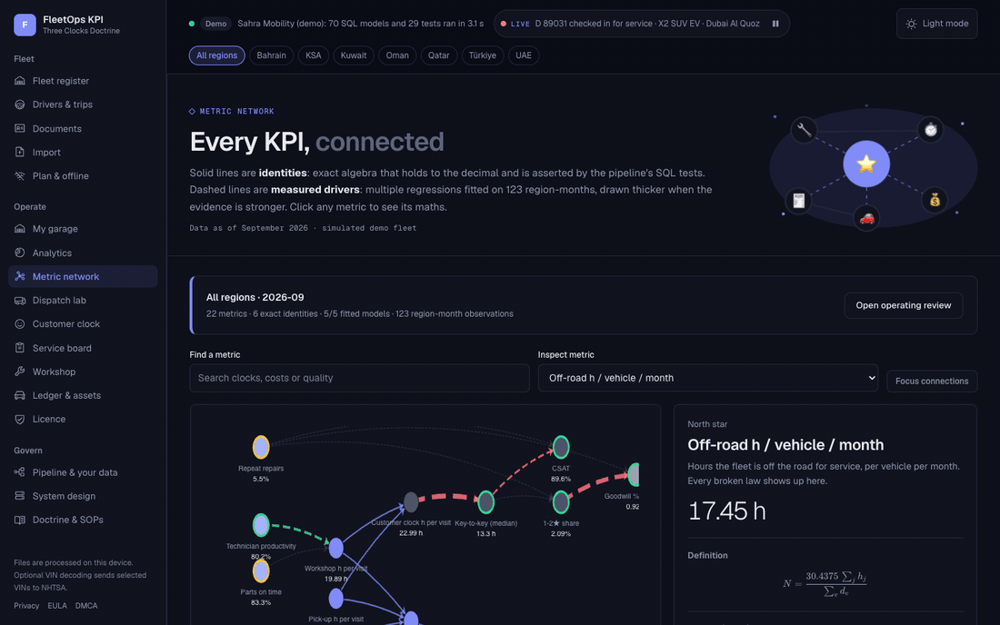

Every KPI is a node. Two kinds of link connect them:

**Identities: exact algebra, asserted by SQL test `t21` on every build**

| | |
|---|---|
| North star = visits per vehicle × off-road hours per visit | $N = V \times H$ |
| Hours per visit = workshop + pick-up + back to operations + still open | $H = W + P + B + O$ |
| Customer clock = workshop + pick-up | $Q = W + P$ |
| Availability is the north star seen from the other side | $A = 100\,(1 - N / 730.5)$ |
| Comebacks inflate visits | $V = V_1 / (1 - \rho)$ |
| Service spend = visits × spend per visit | $C = V \times c$ |

**Measured drivers: multiple OLS on the region × month panel**, $\hat\beta = (X^\top X)^{-1}X^\top y$ with $\operatorname{Var}(\hat\beta) = s^2 (X^\top X)^{-1}$; each link shows β, SE, t, p, 95% CI, R², adjusted R² and F. Productivity and parts on time → workshop hours; customer clock → key-to-key; key-to-key and repeat repairs → CSAT and 1-2★ share; 1-2★ share and repeat repairs → goodwill.

Click any metric to see its definition, its identity with the live numbers substituted, the month-on-month change split exactly across its inputs (log-mean Divisia: $\Delta Y = \sum_i L(Y_1, Y_0)\,\Delta \ln X_i$), and its regression table.

**What-if.** Move a lever (productivity, parts on time, pick-up hours, back-to-ops hours, comeback share, repeat repairs) and the change propagates: $\Delta y = \sum_i \hat\beta_i \Delta x_i$ along measured links, then every identity is re-evaluated exactly. Only drivers significant at p < 0.05 are passed on.

**Job-level evidence** tests the same links on individual work orders:

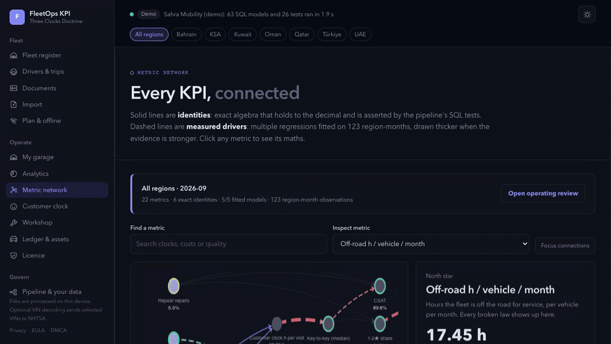

| Claim | Method | Demo result |
|---|---|---|
| Waiting creates detractors | Logistic regression, damped Newton (IRLS); matches `statsmodels` to 6 significant figures | Odds of a 1-2★ rating × 1.98 per extra 10 h key-to-key (95% CI 1.88-2.08), n = 16,472 |
| Fix it once, or pay | Risk ratio (log-method CI) and Welch t-test | Goodwill on 18.5% of comebacks vs 2.0% of first visits: RR 9.3 (8.0-10.8) |
| Late parts move the workshop clock | OLS | Ŵ = 12.0 + 1.115 × parts-wait hours, r = 0.96, n = 49,655 |

The statistics are written from first principles in [`web/src/lib/stats.ts`](web/src/lib/stats.ts) (Lanczos log-gamma, Lentz continued fraction for the incomplete beta, Student-t, Acklam normal quantile, Gauss-Jordan inversion, IRLS) and unit-tested against R and scipy reference values.

## Live dashboards

The dashboards move as data comes in. A **LIVE** badge in the top bar shows the latest event, and the Garage, Analytics and Drivers pages carry a live panel: vehicles on the road and in the workshop, open jobs, kilometres and trips today, alerts and events per minute, a streaming chart and a feed of the latest events sliding in. In the 3D garage, road-ready cars drive out and back as trips and handovers come in.

- **Demo:** a simulated feed generated in the browser from the demo fleet's own vehicles, drivers and sites, labelled as simulated wherever it shows. Pause it any time.
- **Your fleet:** FleetOps has no server, so live data comes from your own files. On **Import**, *Follow a file* watches an export your telematics or fleet system keeps updating; when it changes, it is re-imported with the mapping you already confirmed and every dashboard rebuilds (Chrome and Edge). The file never leaves your computer.

## Drivers, trips and alert rules

Import a drivers sheet (licence class and expiry, assigned vehicle) and a trips export from your telematics provider (Geotab, Webfleet, Samsara, Motive: one row per trip, or per vehicle and day or week). FleetOps scores every driver 0-100 from speeding, harsh driving, idling and zone exits, and runs an **alert rules engine** in SQL: speeding or harsh driving over a limit per 100 km, idling over a share of engine-on time, leaving the permitted zone, driving on an expired licence, a licence about to expire. The limits sit in `fleet.yml` under `alerts:`; the **Drivers & trips** page lists every alert and every driver, lowest score first, and Analytics adds a Drivers & trips group.

**Driver compliance.** Every driver gets a status (Compliant, Action needed, Not compliant) with the reasons:

- **Licence matches the vehicle:** the class held (B car or van, C truck, CE articulated, D bus; free text such as "light vehicle" or "heavy truck" is understood) must cover the class the assigned vehicle needs, worked out from the model or set per vehicle (`licence_class_required`).
- **Licence up to date:** valid, expiring or expired, with the days left; a driver with trips on an expired licence raises a critical alert.
- **Fines:** count, 12-month count, total and unpaid amount. A fine is matched to the driver named on it, else the driver on a trip that day, else the vehicle's assigned driver, and the profile says which.
- **Tickets on and by the driver:** work orders where they were at the wheel (collisions, breakdowns) and the ones they reported (`driver_id` and `reported_by` on work orders).

Click a driver for the full profile: licence, driving record, the latest fines and every ticket.

The page also carries **25 driver KPIs** in four groups (compliance, safety, fines and tickets, activity) with weekly trends, and charts for driving behaviour by week, tickets on and by drivers by month, compliance by region, licence expiries over the next 12 months, fines on drivers by type (paid and unpaid) and driver safety by site.

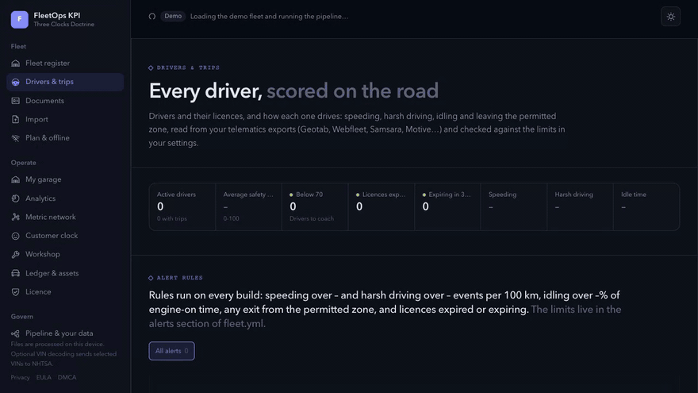

## Architecture: the classic fleet system, local-first

A textbook fleet management system ([for example](https://medium.com/@ahmadlamber/how-to-design-a-fleet-management-system-7ca790dffccf)) streams GPS from in-vehicle devices through Kafka or MQTT into backend services, a relational and a time-series database, a rules engine and a live dashboard. FleetOps covers the same functional ground without a server: the owner's files are the event stream, the browser is the backend.

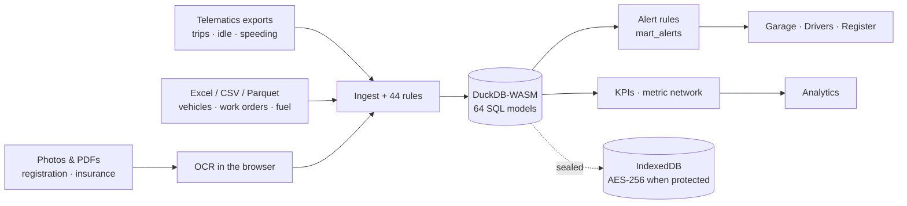

| Classic requirement | In FleetOps |
|---|---|
| Vehicle registration and management | Fleet register: VIN validation and decoding, documents read by OCR, one next action per vehicle |
| Driver management | Drivers sheet: licence class and expiry, assigned vehicle, safety score |
| Real-time GPS, trip and route tracking | Trip summaries imported from the telematics provider; no device or server of our own |
| Fuel consumption monitoring | Fuel L/100 km, electricity kWh/100 km, unusual fuel months |
| Maintenance scheduling | PM intervals by powertrain, overdue and due-soon vehicles, planned maintenance share |
| Alerts (speeding, geofencing, idle time) | SQL rules engine over trips and licences, limits in `fleet.yml` |
| Reporting and analytics | 44 KPIs, region scorecard, metric network, Excel and calendar exports |
| Availability, scalability | A static site and an offline package: nothing to keep up, 6,500 vehicles built in about 2 s |
| Data durability | IndexedDB in the browser; the owner's own files remain the source |
| Security: authentication, TLS, audit logs | No accounts or server to attack; strict CSP, encryption at rest, a sealed activity log of every change |

## Run it yourself

```bash
# the dashboard (TypeScript, Next.js, DuckDB-WASM)
pip install -e . && fleetkpi web-export --out web/public    # export the SQL engine + demo fleet
cd web && npm install && npm run dev                          # http://localhost:3000

# the warehouse and CLI (Python)
pip install git+https://github.com/Pemalahmad/FleetOps-KPI-Dashboard
fleetkpi demo my-fleet && cd my-fleet && fleetkpi build      # 6,500-vehicle demo, ~2 s
```

---

## The Three Clocks Doctrine

> **A vehicle in the workshop runs three clocks at once. Manage all three, or someone pays for the one you forgot.**

```
 key in ──────────── ready ──────── key back ─────────── earning again
   │◄──── Workshop clock ────►│◄ pick-up ►│◄ back to operations ►│
   │◄──────────── Customer clock ────────►│                      │
   │◄──────────────────────────── Fleet clock ───────────────────►│
```

Every KPI here hangs off one of three clocks, a **ledger** (what each visit costs, and who pays) and a **licence** (whether the vehicle may legally drive). Seven laws turn them into decisions, and one north star sums them up: **off-road hours per vehicle per month.** Read the [full doctrine](docs/DOCTRINE.md); the dashboard's **Doctrine & SOPs** page renders it with the eight SOPs.

## The KPIs

| Area | KPI | Definition |
|---|---|---|
| **Customer** | Customer satisfaction (CSAT) | Share of 4-5 star ratings |
| | 1-2 star ratings | Count and share of 1-2 star ratings, by region and site |
| | Average rating | Mean stars, with the full 1-5 distribution |
| | Key-to-key (customer clock) | Median hours from key handed in to key handed back (p50 and p90, % within target) |
| | Time to pick up | Vehicle ready → customer collects the key |
| | Back to operations | Key handed back → vehicle earning again (fleet clock = workshop + pick-up + back to operations) |
| | Goodwill rate | Goodwill paid as % of service spend; tied to 1-2★ ratings and comebacks |
| **Workshop** | Days of backlog | Open jobs ÷ average daily completions over the last 28 days, plus aging buckets (< 1, 1-3, 3-7, 7+ days) |
| | Technician productivity | Billed labour hours ÷ available productive technician hours |
| | Turnaround & INTERVENE | Weekly median turnaround per site vs the network and its own trend |
| | First-time fix | Share of jobs with no repeat visit |
| | Repeat repairs | Repair or warranty job for the same issue category within the repeat window (default 14 days) |
| | Repeat visits | Any unplanned return within the window, whatever the fault |
| | Common repair & issue categories | Jobs, cost, key-to-key and repeat % across 12 standard categories (HV battery, brakes, software & sensors…) by powertrain |
| | Parts arrival vs ETA | Parts on time %, days late, lead time and open overdue orders, by supplier |
| **Fleet & assets** | Availability / utilisation | Vehicle-hours on the road; operating hours vs plan |
| | Time in service | Days since entering service, age bands by powertrain |
| | Depreciation & book value | Straight-line or declining-balance to a residual value; book value, monthly depreciation, value retained |
| | Cost per km & TCO | Energy + fleet-paid maintenance + depreciation, by powertrain; L/100 km, kWh/100 km, CO₂ g/km |
| | Service spend per vehicle | Total amount paid on each vehicle for services, per visit and per 1,000 km, with goodwill shown separately |
| **Compliance** | Registration status | Valid / Expiring (inside the renewal window) / Expired / Unknown, valid %, renewal calendar |
| | Insurance status | Same, by insurer |
| | Preventive maintenance | Inside the km-or-months interval for each powertrain |
| | Recalls | Completion % and curve per campaign and region |
| | Fines registered | Fines per 100 vehicles, amount, unpaid, by type (speeding, parking, toll…) and repeat-offender vehicles |
| | Cost vs budget | Fleet-paid maintenance vs budget, by region and month |

Every KPI has a green/amber/red target in `fleet.yml`. The gamified **Ops Score** (0-1,000, Platinum/Gold/Silver/Bronze, streaks, badges) is built only from these KPIs: key-to-key, first-time fix, CSAT, productivity and PM compliance.

| | |
|---|---|
| 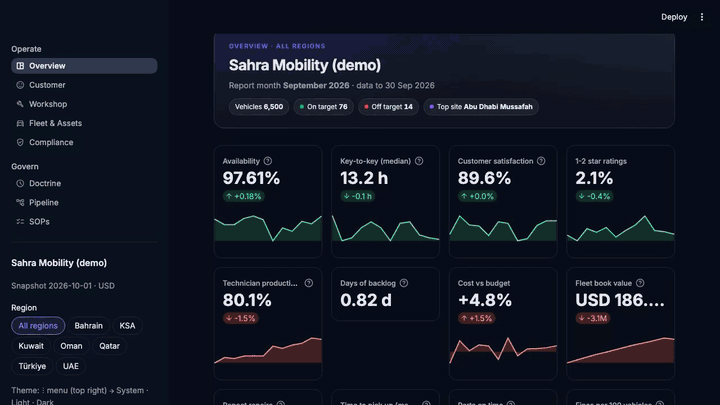 | 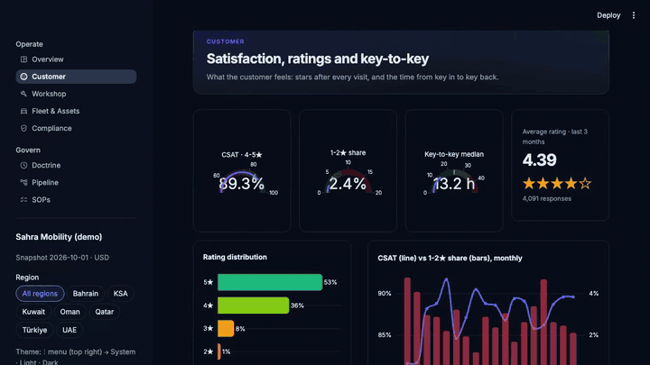 |
| 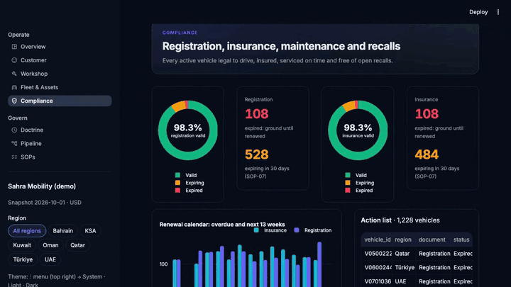 | 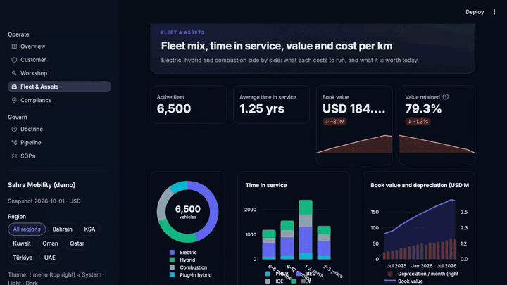 |

## The pipeline: SQL first, dbt-style

In the web app the same run is drawn as a live **work tree**: your files flow through the checks, the SQL models and the data tests into the garage, register, analytics and metric network, with this run's counts on every node and a run log beside it.

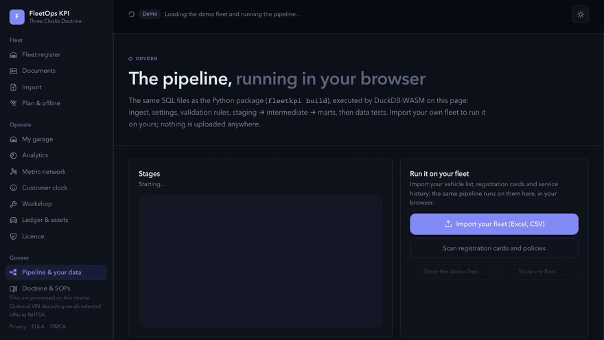


```
fleetkpi/sql/
├── macros/          rag(), book_value(), doc_status(), price and CO₂ lookups
├── validation/      v01…v34  raw-data rules: a SELECT returning offending ids (0 rows = pass)
├── models/
│   ├── staging/     stg_*   one clean, typed model per input table
│   ├── intermediate/int_*   vehicle-months, visits & repeats, downtime, PM status, weekly site status
│   └── marts/       mart_*  every KPI the dashboard reads
└── tests/           t01…t22  data tests on the models (grain, ranges, reconciliation, clock and network identities)
```

- **One model per file, as a plain `SELECT`.** The runner (`fleetkpi/sqlrunner.py`) reads the `FROM`/`JOIN`s to find dependencies, sorts the models, refuses a model that depends on a later layer, materialises each one as a view or table, and records rows, timing and lineage.
- **Validation and tests are SQL too.** `validation/` checks your raw data (duplicates, orphans, impossible dates, ratings outside 1-5…); `tests/` checks the models (one row per vehicle per month, book value between residual and cost, cost reconciles to work orders…).
- **Everything is logged into the warehouse.** `pipeline_runs`, `pipeline_models`, `pipeline_tests`, `validation_issues` and `ingest_log` drive the Pipeline page: stage cards, a lineage graph drawn from the real dependencies, model and test SQL, and a *Run pipeline* button.
- **Self-documenting.** `fleetkpi docs` writes [`docs/SQL_CATALOG.md`](docs/SQL_CATALOG.md) from each file's header: every model, what it reads and what reads it.

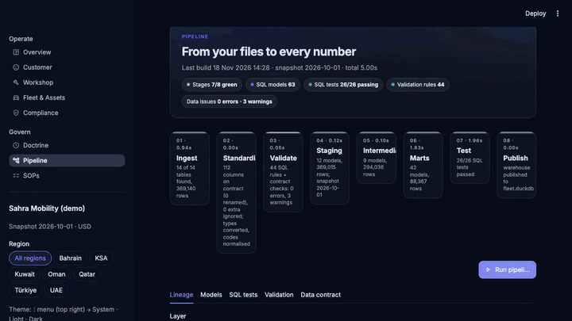

## Plug and play, for any powertrain

| | |
|---|---|
| **Your files, your column names** | CSV, Excel, Parquet or JSON. 317 column synonyms are recognised (`Plate No` → `vehicle_id`, `Date In` → `opened_at`, `Mulkiya Expiry` → `registration_expiry`); map anything else once in `fleet.yml`. |
| **Your codes, normalised** | `Electric`, `EV`, `Plug-in Hybrid`, `Petrol`, `Diesel` → BEV / PHEV / HEV / ICE (diesel kept for CO₂). `Oil service`, `Breakdown`, `Accident repair` → standard job types. `dd/mm/yyyy` dates and `1,250.00` amounts just work. |
| **Four tables required, seven optional** | `sites`, `vehicles`, `work_orders`, `usage` are required; add `energy`, `feedback`, `parts_orders`, `fines`, `recalls`, `recall_vehicles`, `budgets` when you have them. Missing tables hide their sections; nothing breaks. |
| **One settings file** | Currency, operating and productive hours, prices and CO₂ factors by region, PM intervals per powertrain, depreciation method and residual, renewal window, targets, scoring weights. |

```bash
fleetkpi init my-fleet    # fleet.yml + 11 CSV templates + DATA_CONTRACT.md
fleetkpi validate         # what is wrong with my data, in plain language
fleetkpi build            # run the eight stages
fleetkpi serve            # open the dashboard (light / dark / system)
fleetkpi docs             # regenerate the SQL catalog and data contract

docker build -t fleetkpi . && docker run -p 8501:8501 -v "$PWD/my-fleet:/fleet" fleetkpi
```

## The dashboard

The workspace includes **My garage** (vehicle bays, accident recovery, renewal stages, road checklists, alerts and recovery missions), **Plan & offline** (install, offline package, licence), **Fleet register** (identity, licence and next action for every vehicle, with a vehicle drawer), **Documents** (scan, review, vault), **Import** (workbooks, mapping, templates), **Analytics** (north star, KPI tiles with sparklines, region × KPI scorecard, site league), **Metric network** (metric search, keyboard selection, focused connections and links to procedures), **Customer clock** (the three clocks by region, CSAT, rating mix, key-to-key p50/p90), **Workshop** (weekly INTERVENE heatmap, repeat repairs, issue-category treemap, supplier on-time, overdue parts, backlog ageing), **Ledger & assets** (spend per 1,000 km by powertrain, goodwill, cost vs budget, cost per km, value retained), **Licence** (registration and insurance status, renewal waves, PM, fines, recall curves), **Pipeline & your data** and **Doctrine & SOPs**. A global region filter applies everywhere; light and dark follow the system or a toggle.

Built in TypeScript with Next.js (static export), Tailwind, ECharts, KaTeX and DuckDB-WASM, following the structure of a production browser-tools app: self-hosted WASM assets copied at build time, Vitest for the maths, ESLint and type-checking in CI, deployed to GitHub Pages by [`pages.yml`](.github/workflows/pages.yml). The Python package still ships a local Streamlit view (`fleetkpi serve`) for teams that prefer it.

| | |
|---|---|
| 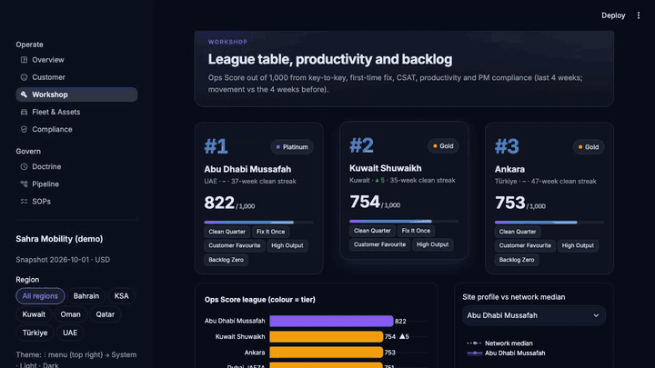 | 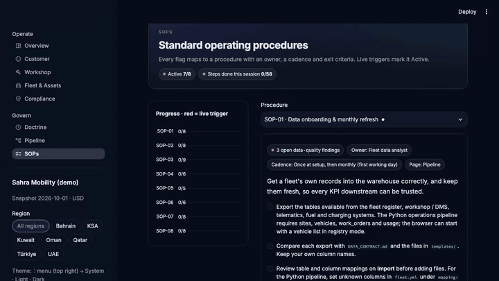 |

**Eight SOPs** (data onboarding, weekly review, site intervention, recalls, PM compliance, month-end cost, registration, insurance & fines, customer recovery & goodwill) carry an owner, cadence, trigger and checklist, and show live evidence when the data trips their trigger. The browser SOP workspace adds scoped checklists, named owners, due dates, evidence notes and downloadable reviews. Completing a checklist does not clear a live operational flag.

## The demo fleet

*Sahra Mobility* is **fictional**: 6,500 vehicles (45% BEV, 25% HEV, 10% PHEV, 20% ICE), 15 workshops, 7 markets, 18 months. It is generated in SQL with customer ratings, all four handover timestamps, comebacks, parts orders with promised ETAs and back-orders, fines, goodwill, and registration and insurance dates, exported as ordinary contract files, and loaded back through the same eight stages as anyone's data. Its operating stories are tested: the **Riyadh North** parts-and-attrition crisis is flagged INTERVENE for 18 weeks, pushes KSA's 1-2 star share up, drops KSA parts on-time below 50% in May 2026, and recovers. All figures come from synthetic inputs and illustrate the method; they are not benchmarks.

## Quality

- **24 SQL data tests** and **41 SQL validation rules** run inside every build, in Python and in the browser alike, including the clock identity on every work order (`t18`) and the metric-network identities on every region-month (`t21`).
- **Security and garage end-to-end tests** (Playwright, production build in a real browser): strict CSP with no violations on every page, an injected script refused, a hostile workbook (XSS and SQL injection) rendered as text, a clickjacking guard, encryption at rest (fleet data and SOP notes) with wrong and right passphrases, and the document reader under the policy, with every request staying on the app's own site.
- **116 TypeScript tests** (Vitest), including **property-based fuzzing** (fast-check) of every parser that reads untrusted input: encryption at rest (round trip, wrong passphrase, tamper detection, fresh IVs); licence keys signed in Python and verified in the browser (forged and expired keys rejected); calendar and Excel exports (formula injection neutralised); every statistical routine against R / scipy / statsmodels reference values; the metric network's identities and propagation; VIN rules and vPIC mapping; workbook reading (title rows, Excel dates, many sheets) and table / column recognition for common fleet-platform exports; document reading (day-first and Arabic-Indic dates, plates, VINs, weighted document typing); vehicle-name cleaning, car-shape guessing and the 3D car bodies (finite, inside the footprint, glass on every style).
- **26 Python tests** (`pytest`): licence signing; the demo end to end; the fleet register and documents (matched by plate, VIN or id; renewed cards move the expiry); VIN macros against reference VINs; a foreign-format fleet (Excel, its own column names, `dd/mm` dates, monthly usage, no optional tables) that must plug in with mapping only; bad data blocked with the right reasons; dependency order and layer rules; the web export runs exactly the package's SQL.
- **CI** on Python 3.11 and 3.13, the web app (lint, type-check, tests, build), and a Docker build that runs the demo inside the image.

## Repository map

| Path | What lives there |
|---|---|
| [`fleetkpi/sql/`](fleetkpi/sql) | The warehouse: macros, validation rules, staging → intermediate → marts, data tests, demo generator |
| [`web/`](web) | The dashboard: Next.js + TypeScript, DuckDB-WASM engine (`src/lib/engine.ts`), statistics (`src/lib/stats.ts`), metric network (`src/lib/metrics.ts`), pages (`src/app/`) |
| [`docs/FLEET_SOFTWARE.md`](docs/FLEET_SOFTWARE.md) | The owner's path, and what FleetOps takes from Fleetio, Samsara, Motive, Geotab and Verizon Connect |
| `fleetkpi/webexport.py` | Exports the SQL (models in run order, rules, tests, ingest expressions, settings) and the demo fleet for the browser |
| [`fleetkpi/app/`](fleetkpi/app) | The local Streamlit view (`fleetkpi serve`) |
| [`fleetkpi/sops/`](fleetkpi/sops) | Eight SOPs, each with owner, cadence, trigger and checklist |
| `fleetkpi/*.py` | `cli` commands · `contract` (tables, columns, synonyms) · `ingest` (read + normalise) · `validate` · `sqlrunner` (dbt-style runner) · `build` (eight stages) · `config` (`fleet.yml`) · `demo` |
| `fleetkpi/fleet.example.yml` | Every setting and green/amber/red target, commented |
| [`samples/`](samples) | A messy vehicle-list workbook and a fictional registration card to try the app with |
| [`docs/`](docs) | The doctrine, the generated SQL catalog and data contract, screenshots |
| [`tests/`](tests) | Python tests: the demo end to end, a foreign-format fleet, bad data, the runner |
| `Dockerfile`, `.github/workflows/` | Container image, CI (Python, web, Docker) and the GitHub Pages deploy |


## Licence

[Functional Source License 1.1, MIT future licence](LICENSE.md) (FSL-1.1-MIT). Use it, change it and run it for your
own fleet, for research or teaching, or for clients you serve; what you may not do is sell it, or a copy of it, as a
competing product. Each release becomes plain MIT two years after it is published. Versions up to 0.5.0 were
released under MIT and stay MIT.

---

Built by [Mohammad Alahmad](https://linkedin.com/in/pemalahmad). The structure mirrors how I ran operations analytics for a multi-market EV network; the demo company and its data are invented.


