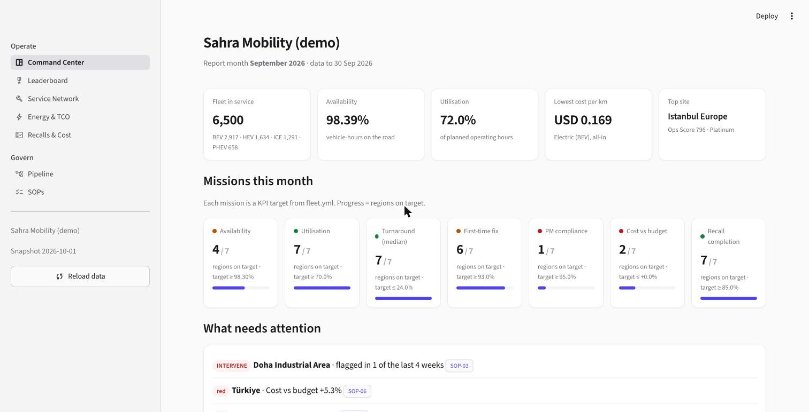
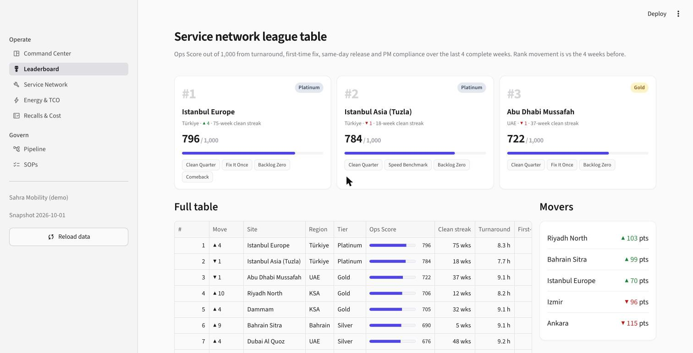
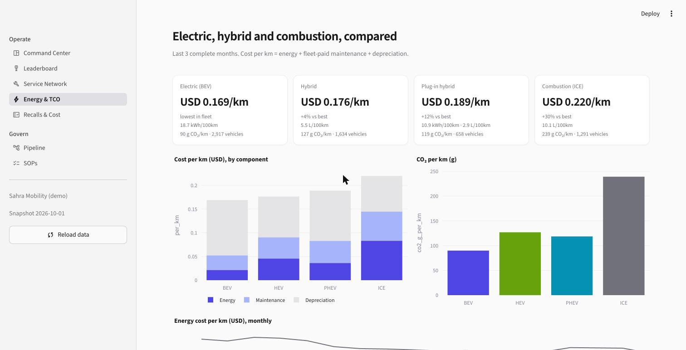
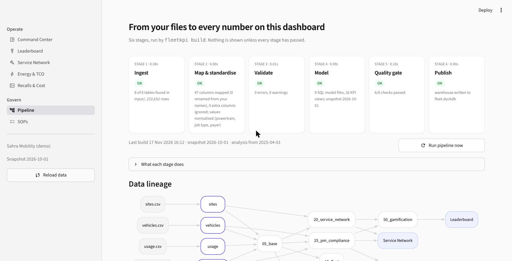
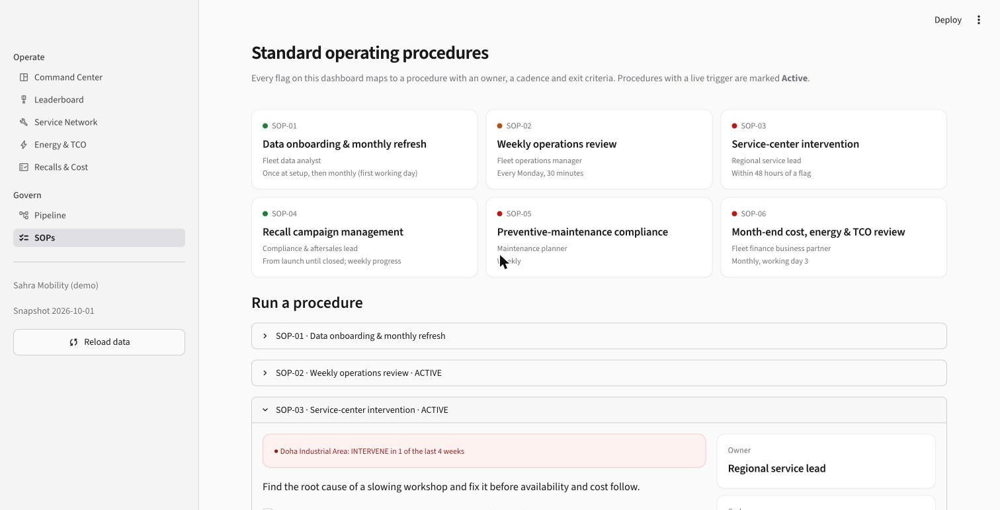
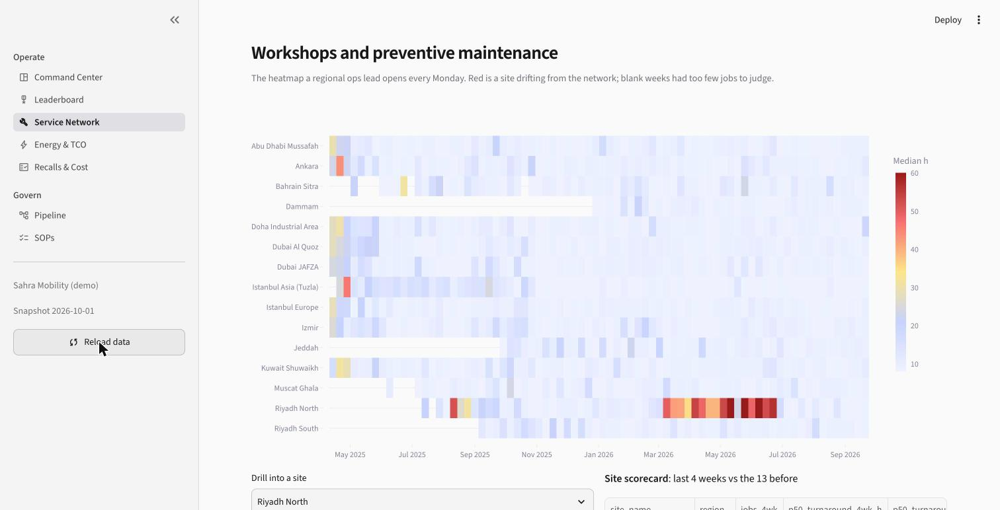
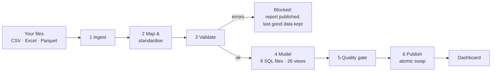

# fleetkpi: plug-and-play fleet operations KPIs

**Drop in your fleet's own files — electric, hybrid or combustion — and get a validated KPI warehouse and a gamified operations cockpit, with the full data pipeline and the SOPs behind every flag.**


```bash
pip install git+https://github.com/Pemalahmad/fleet-ops-kpi-dashboard
fleetkpi demo my-fleet && cd my-fleet && fleetkpi serve      # 6,500-vehicle demo in ~1 second
```



---

## Why it exists

Every fleet team asks the same questions: *Is the fleet on the road? Which workshop needs me this week? What does a kilometre actually cost — electric vs hybrid vs petrol? Are we inside service intervals, on budget, and finished on recalls?* The answers usually live in five systems and a spreadsheet. fleetkpi turns those exports into one trusted set of numbers, and gives the people who act on them a reason to look every day.

## Plug and play, for any powertrain

| | |
|---|---|
| **Your files, your column names** | CSV, Excel, Parquet or JSON. Columns are matched case-insensitively with 180+ synonyms (`Plate No` → `vehicle_id`, `Date In` → `opened_at`); anything else is mapped once in `fleet.yml`. |
| **Your codes, normalised** | `Electric`, `EV`, `Plug-in Hybrid`, `Petrol`, `Diesel` → BEV / PHEV / HEV / ICE. `Oil service`, `Breakdown`, `Accident repair` → standard job types. Dates in `dd/mm/yyyy` and amounts like `1,250.00` just work. |
| **Only four tables required** | `sites`, `vehicles`, `work_orders`, `usage`. Add `energy`, `recalls`, `budgets` when you have them; missing optional tables simply hide their sections. |
| **Plain-language validation** | Bad data never crashes a load. It is reported — *"Work order for a vehicle not in vehicles (3), e.g. WO123 → GHOST-1"* — and errors block publishing so nobody acts on wrong numbers. |
| **One settings file** | Currency, operating hours, fuel & electricity prices, CO₂ factors by region, service intervals per powertrain, budgets, targets and scoring weights: all in `fleet.yml`. |

```bash
fleetkpi init my-fleet     # fleet.yml + 8 CSV templates + DATA_CONTRACT.md
# put your exports in my-fleet/data/input/
fleetkpi validate          # what's wrong with my data, in plain language
fleetkpi build             # run the pipeline
fleetkpi serve             # open the dashboard
```

Or with Docker (mount a project folder; an empty folder starts the demo):

```bash
docker build -t fleetkpi .
docker run -p 8501:8501 -v "$PWD/my-fleet:/fleet" fleetkpi
```

## What you get

| Page | What it answers |
|---|---|
| **Command Center** | KPI cards, **missions** (regions on target per KPI), *What needs attention* — every item tagged with the SOP that handles it — and a RAG region scorecard. |
| **Leaderboard** | Site **Ops Score** (0–1,000), Platinum/Gold/Silver/Bronze tiers, rank movement, clean-week streaks, badges (*Clean Quarter, Fix It Once, Speed Benchmark, PM Perfect, Backlog Zero, Comeback*) and movers. |
| **Service Network** | Weekly turnaround heatmap with **INTERVENE / WATCH** flags, site drill-down, site scorecard, preventive-maintenance compliance by powertrain, aged backlog. |
| **Energy & TCO** | Cost per km by powertrain (energy + maintenance + depreciation), L/100km and kWh/100km, CO₂ g/km, trends, and the most expensive vehicles per km. |
| **Recalls & Cost** | Campaign completion and curves; fleet-paid maintenance vs budget by region and month. |
| **Pipeline** | All six stages with status and timings, **data lineage** from your files to every page, contract coverage, validation findings, quality gate, the SQL itself — and a *Run pipeline now* button. |
| **SOPs** | Six procedures (data onboarding, weekly review, service-center intervention, recalls, PM compliance, month-end cost & TCO) with owner, cadence, trigger, **live “Active” status** from the data, and interactive checklists. |

| | |
|---|---|
|  |  |
|  |  |



## The pipeline



All KPI logic is SQL (`fleetkpi/sql/models/`): window functions for baselines and trends, `FILTER` aggregates for period comparisons, region-aware price and CO₂ lookups, and a `rag()` macro driven by your targets. The app only renders the views.

## The demo fleet

*Sahra Mobility* is **fictional**: 6,500 vehicles (45% BEV, 25% HEV, 10% PHEV, 20% ICE) across the UAE, KSA, Qatar, Kuwait, Bahrain, Oman and Türkiye, 15 workshops, 18 months. It is generated in SQL, exported to ordinary contract files, and loaded back through the same path as a customer's data. Two operating stories are planted, and the tests require the dashboard to catch them: a **Riyadh North** parts-and-attrition crisis (18 INTERVENE weeks, then a +103-point comeback on the leaderboard) and an **Istanbul Asia** turnaround.

On the demo, the all-in cost per km comes out as electric **0.169**, hybrid **0.176**, plug-in hybrid **0.189**, combustion **0.220** (USD), with 90 vs 239 g CO₂/km. These come from the synthetic inputs, so treat them as an illustration of the method, not a market benchmark.

## Quality

- **11 tests** (`pytest`): the demo end to end; a foreign-format fleet (Excel, own column names, `dd/mm` dates, free-text codes, no optional tables) that must plug in with mapping only; bad data that must be blocked with the right reasons; auto-synonym mapping; `init`.
- **CI** on Python 3.10 and 3.12, plus a Docker build that runs the demo inside the image.
- **Deterministic**: hash-based demo data, so every build is identical.

---

Built by [Mohammad Alahmad](https://linkedin.com/in/pemalahmad) with Claude Code. The structure mirrors how I ran operations analytics for a multi-market EV network; the demo company and its data are invented. MIT licensed.
