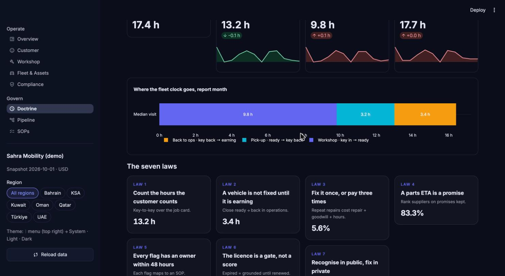
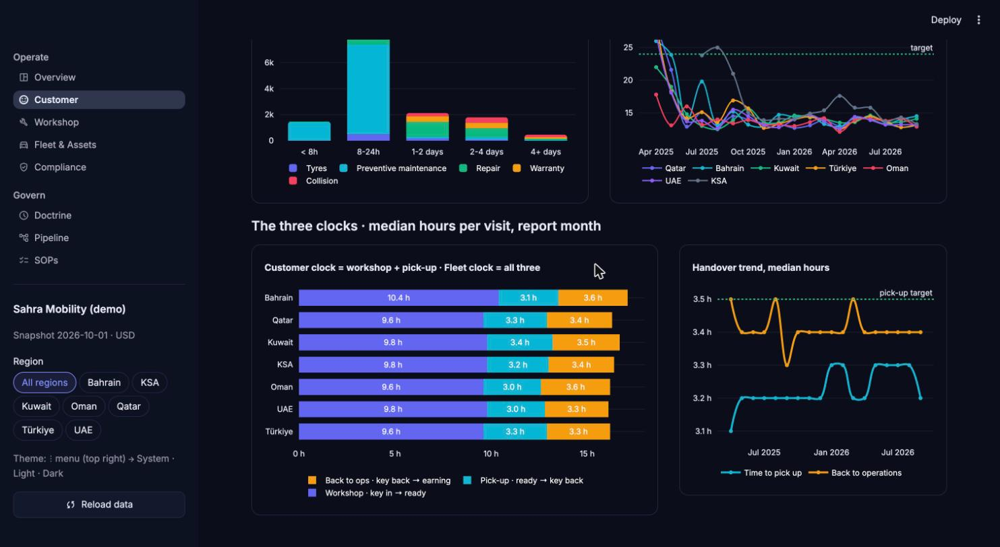
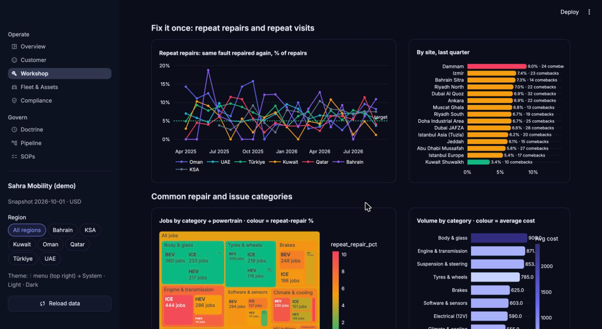
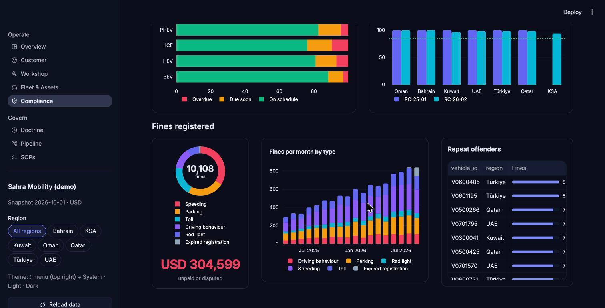
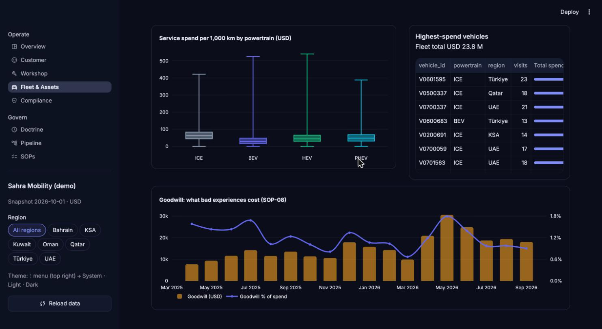
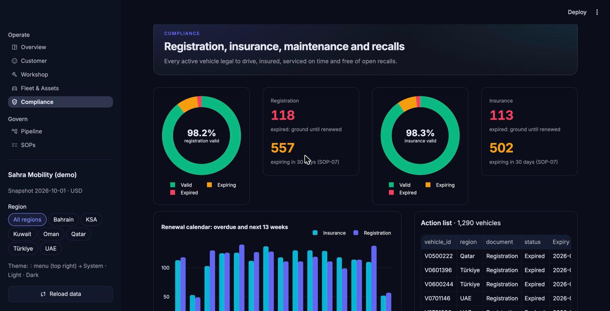
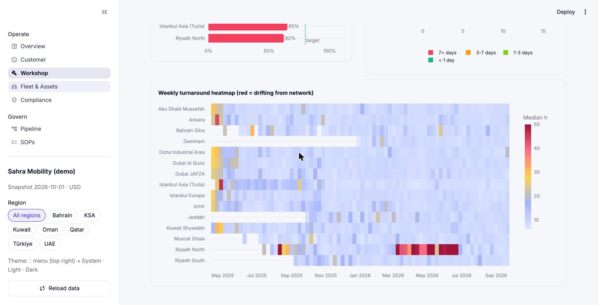

# fleetkpi: plug-and-play fleet operations KPIs

**Drop in your fleet's own files — electric, hybrid or combustion — and get a tested SQL warehouse and a live, gamified operations cockpit in light and dark, with the full pipeline and the SOP behind every flag.**


```bash
pip install git+https://github.com/Pemalahmad/fleet-ops-kpi-dashboard
fleetkpi demo my-fleet && cd my-fleet && fleetkpi serve       # 6,500-vehicle demo, built in ~1.5 s
```

| Light | Dark |
|---|---|
|  |  |

---

## The Three Clocks Doctrine

> **A vehicle in the workshop runs three clocks at once. Manage all three, or someone pays for the one you forgot.**

```
 key in ──────────── ready ──────── key back ─────────── earning again
   │◄──── Workshop clock ────►│◄ pick-up ►│◄ back to operations ►│
   │◄──────────── Customer clock ────────►│                      │
   │◄──────────────────────────── Fleet clock ───────────────────►│
```

Every KPI here hangs off one of three clocks, a **ledger** (what each visit costs, and who pays) and a **licence** (whether the vehicle may legally drive). Seven laws turn them into decisions, and one north star sums them up: **off-road hours per vehicle per month.** Read the [full doctrine](docs/DOCTRINE.md); the dashboard's **Doctrine** page shows it live.



## The KPIs

| Area | KPI | Definition |
|---|---|---|
| **Customer** | Customer satisfaction (CSAT) | Share of 4-5 star ratings |
| | 1-2 star ratings | Count and share of 1-2 star ratings, by region and site |
| | Average rating | Mean stars, with the full 1-5 distribution |
| | Key-to-key (customer clock) | Median hours from key handed in to key handed back (p50 and p90, % within target) |
| | Time to pick up | Vehicle ready → customer collects the key |
| | Back to operations | Key handed back → vehicle earning again (fleet clock = workshop + pick-up + back to operations) |
| | Goodwill rate | Goodwill paid as % of service spend; tied to 1-2★ ratings and comebacks |
| **Workshop** | Days of backlog | Open jobs ÷ average daily completions over the last 28 days, plus aging buckets (< 1, 1-3, 3-7, 7+ days) |
| | Technician productivity | Billed labour hours ÷ available productive technician hours |
| | Turnaround & INTERVENE | Weekly median turnaround per site vs the network and its own trend |
| | First-time fix | Share of jobs with no repeat visit |
| | Repeat repairs | Repair or warranty job for the same issue category within the repeat window (default 14 days) |
| | Repeat visits | Any unplanned return within the window, whatever the fault |
| | Common repair & issue categories | Jobs, cost, key-to-key and repeat % across 12 standard categories (HV battery, brakes, software & sensors…) by powertrain |
| | Parts arrival vs ETA | Parts on time %, days late, lead time and open overdue orders, by supplier |
| **Fleet & assets** | Availability / utilisation | Vehicle-hours on the road; operating hours vs plan |
| | Time in service | Days since entering service, age bands by powertrain |
| | Depreciation & book value | Straight-line or declining-balance to a residual value; book value, monthly depreciation, value retained |
| | Cost per km & TCO | Energy + fleet-paid maintenance + depreciation, by powertrain; L/100 km, kWh/100 km, CO₂ g/km |
| | Service spend per vehicle | Total amount paid on each vehicle for services, per visit and per 1,000 km, with goodwill shown separately |
| **Compliance** | Registration status | Valid / Expiring (inside the renewal window) / Expired / Unknown, valid %, renewal calendar |
| | Insurance status | Same, by insurer |
| | Preventive maintenance | Inside the km-or-months interval for each powertrain |
| | Recalls | Completion % and curve per campaign and region |
| | Fines registered | Fines per 100 vehicles, amount, unpaid, by type (speeding, parking, toll…) and repeat-offender vehicles |
| | Cost vs budget | Fleet-paid maintenance vs budget, by region and month |

Every KPI has a green/amber/red target in `fleet.yml`. The gamified **Ops Score** (0-1,000, Platinum/Gold/Silver/Bronze, streaks, badges) is built only from these KPIs: key-to-key, first-time fix, CSAT, productivity and PM compliance.

| | |
|---|---|
|  |  |
|  |  |

## The pipeline: SQL first, dbt-style


```
fleetkpi/sql/
├── macros/          rag(), book_value(), doc_status(), price and CO₂ lookups
├── validation/      v01…v34  raw-data rules: a SELECT returning offending ids (0 rows = pass)
├── models/
│   ├── staging/     stg_*   one clean, typed model per input table
│   ├── intermediate/int_*   vehicle-months, visits & repeats, downtime, PM status, weekly site status
│   └── marts/       mart_*  every KPI the dashboard reads
└── tests/           t01…t20  data tests on the models (grain, ranges, reconciliation, clock identity)
```

- **One model per file, as a plain `SELECT`.** The runner (`fleetkpi/sqlrunner.py`) reads the `FROM`/`JOIN`s to find dependencies, sorts the models, refuses a model that depends on a later layer, materialises each one as a view or table, and records rows, timing and lineage.
- **Validation and tests are SQL too.** `validation/` checks your raw data (duplicates, orphans, impossible dates, ratings outside 1-5…); `tests/` checks the models (one row per vehicle per month, book value between residual and cost, cost reconciles to work orders…).
- **Everything is logged into the warehouse.** `pipeline_runs`, `pipeline_models`, `pipeline_tests`, `validation_issues` and `ingest_log` drive the Pipeline page: stage cards, a lineage graph drawn from the real dependencies, model and test SQL, and a *Run pipeline* button.
- **Self-documenting.** `fleetkpi docs` writes [`docs/SQL_CATALOG.md`](docs/SQL_CATALOG.md) from each file's header: every model, what it reads and what reads it.


## Plug and play, for any powertrain

| | |
|---|---|
| **Your files, your column names** | CSV, Excel, Parquet or JSON. 317 column synonyms are recognised (`Plate No` → `vehicle_id`, `Date In` → `opened_at`, `Mulkiya Expiry` → `registration_expiry`); map anything else once in `fleet.yml`. |
| **Your codes, normalised** | `Electric`, `EV`, `Plug-in Hybrid`, `Petrol`, `Diesel` → BEV / PHEV / HEV / ICE (diesel kept for CO₂). `Oil service`, `Breakdown`, `Accident repair` → standard job types. `dd/mm/yyyy` dates and `1,250.00` amounts just work. |
| **Four tables required, seven optional** | `sites`, `vehicles`, `work_orders`, `usage` are required; add `energy`, `feedback`, `parts_orders`, `fines`, `recalls`, `recall_vehicles`, `budgets` when you have them. Missing tables hide their sections; nothing breaks. |
| **One settings file** | Currency, operating and productive hours, prices and CO₂ factors by region, PM intervals per powertrain, depreciation method and residual, renewal window, targets, scoring weights. |

```bash
fleetkpi init my-fleet    # fleet.yml + 11 CSV templates + DATA_CONTRACT.md
fleetkpi validate         # what is wrong with my data, in plain language
fleetkpi build            # run the eight stages
fleetkpi serve            # open the dashboard (light / dark / system)
fleetkpi docs             # regenerate the SQL catalog and data contract

docker build -t fleetkpi . && docker run -p 8501:8501 -v "$PWD/my-fleet:/fleet" fleetkpi
```

## The dashboard

Eight pages, all charts: KPI tiles with sparklines and deltas, gauges against target bands, donuts you can click to filter, radar profiles, heatmaps, a renewal calendar and a region × KPI scorecard matrix. A global region filter applies everywhere. **Light, dark or follow the system:** ⋮ menu → System · Light · Dark. Custom elements are tinted from the current text colour, so they switch with the theme instantly.

| | |
|---|---|
|  |  |
|  |  |

**Eight SOPs** (data onboarding, weekly review, site intervention, recalls, PM compliance, month-end cost, registration, insurance & fines, customer recovery & goodwill) carry an owner, cadence, trigger and checklist, and go *Active* automatically when the data trips their trigger.

## The demo fleet

*Sahra Mobility* is **fictional**: 6,500 vehicles (45% BEV, 25% HEV, 10% PHEV, 20% ICE), 15 workshops, 7 markets, 18 months. It is generated in SQL with customer ratings, all four handover timestamps, comebacks, parts orders with promised ETAs and back-orders, fines, goodwill, and registration and insurance dates, exported as ordinary contract files, and loaded back through the same eight stages as anyone's data. Its operating stories are tested: the **Riyadh North** parts-and-attrition crisis is flagged INTERVENE for 18 weeks, pushes KSA's 1-2 star share up, drops KSA parts on-time below 50% in May 2026, and recovers. All figures come from synthetic inputs and illustrate the method; they are not benchmarks.

## Quality

- **20 SQL data tests** and **34 SQL validation rules** run inside every build, including the clock identity (fleet = workshop + pick-up + back to operations on every work order).
- **15 Python tests** (`pytest`): the demo end to end; a foreign-format fleet (Excel, its own column names, `dd/mm` dates, monthly usage, no optional tables) that must plug in with mapping only; bad data blocked with the right reasons; dependency order and layer rules.
- **CI** on Python 3.10 and 3.12, plus a Docker build that runs the demo inside the image.

## Repository map

| Path | What lives there |
|---|---|
| [`fleetkpi/sql/`](fleetkpi/sql) | The warehouse: macros, validation rules, staging → intermediate → marts, data tests, demo generator |
| [`fleetkpi/app/`](fleetkpi/app) | The Streamlit dashboard: pages, design system, light/dark theme |
| [`fleetkpi/sops/`](fleetkpi/sops) | Eight SOPs, each with owner, cadence, trigger and checklist |
| `fleetkpi/*.py` | `cli` commands · `contract` (tables, columns, synonyms) · `ingest` (read + normalise) · `validate` · `sqlrunner` (dbt-style runner) · `build` (eight stages) · `config` (`fleet.yml`) · `demo` |
| `fleetkpi/fleet.example.yml` | Every setting and green/amber/red target, commented |
| [`docs/`](docs) | The doctrine, the generated SQL catalog and data contract, screenshots |
| [`tests/`](tests) | Python tests: the demo end to end, a foreign-format fleet, bad data, the runner |
| `Dockerfile`, `.github/workflows/` | Container image and CI (Python 3.10 and 3.12, plus a Docker build) |

---

Built by [Mohammad Alahmad](https://linkedin.com/in/pemalahmad). The structure mirrors how I ran operations analytics for a multi-market EV network; the demo company and its data are invented. MIT licensed.
