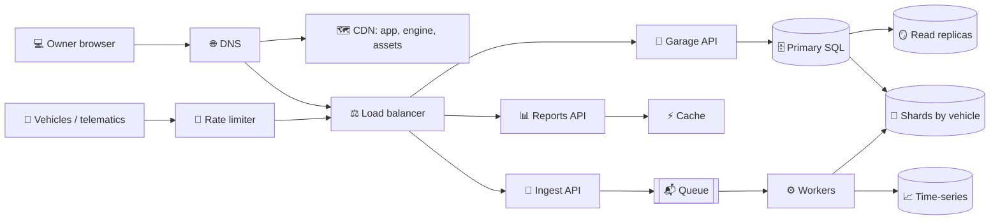

# System design

How a fleet platform stays fast and up when thousands of vehicles report at once, and honestly where FleetOps stands.
FleetOps runs entirely in the owner's browser with no servers of its own (see [AGENTS.md](../AGENTS.md)), so the
hosted-infrastructure pieces below describe the reference design for a hosted version, not something the app does today.
The same content, with live demos, is on the app's **System design** page.

## Reference architecture

FleetOps today is the left edge of this picture: the browser plus GitHub Pages' CDN. The warehouse (DuckDB), the
garage and the documents all run on the owner's device.

## Building blocks

| | Topic | Status |
|---|---|---|
| 🌐 | [DNS](#dns) | Partly, in the browser |
| ⚖️ | [Load balancing](#lb) | Hosted version only |
| 🗺️ | [CDNs](#cdn) | In FleetOps now |
| ⚡ | [Caching](#cache) | In FleetOps now |
| 🚦 | [Rate limiting](#rate) | In FleetOps now |
| 🗃️ | [SQL vs NoSQL](#sql) | Partly, in the browser |
| 🔎 | [Indexing](#index) | Partly, in the browser |
| 🪞 | [Replication](#replication) | Hosted version only |
| 🧩 | [Sharding](#sharding) | Hosted version only |
| 🔺 | [CAP theorem](#cap) | Partly, in the browser |
| 🧱 | [Microservices](#micro) | Hosted version only |
| 🔌 | [Circuit breaker](#breaker) | In FleetOps now |
| 📨 | [Messages](#messages) | Partly, in the browser |
| 📬 | [Queues](#queues) | Partly, in the browser |

### 🌐 DNS

The internet's phone book: turns a name like fleet.example.com into the address of a server, and can steer each visitor to the nearest region.

- **At fleet scale:** One name per tenant or region (uae.fleet…, ksa.fleet…) with short time-to-live records, so a region can fail over in minutes; health-checked records drop a dead data centre automatically.
- **In FleetOps:** GitHub's DNS serves pemalahmad.github.io. FleetOps has no servers of its own to point at: the app runs in your browser.

### ⚖️ Load balancing

Spreads incoming requests across several identical servers so none is overloaded, and stops sending traffic to a server that fails its health check.

- **At fleet scale:** A layer-7 balancer in front of the API pods, round-robin for dashboards and sticky by vehicle for live telematics streams; drain a pod before deploying it.
- **In FleetOps:** Not needed: every owner's browser is its own compute, so there is nothing to balance. A hosted version would add it.

### 🗺️ CDNs

Copies of static files (the app, scripts, styles, images) kept on servers close to users, so pages load fast anywhere.

- **At fleet scale:** Serve the app shell, the DuckDB engine and the demo data from edge caches in the Gulf; give every build file a content hash so it can be cached forever.
- **In FleetOps:** GitHub Pages serves the whole app from its CDN, and every script is fingerprinted. Nothing else is fetched from any other host.

### ⚡ Caching

Keeping the answer to an expensive question close at hand, so the next time it is asked it comes back instantly. The hard part is knowing when the answer is stale.

- **At fleet scale:** Redis in front of the reports API for KPI tiles (invalidated when a job card closes), HTTP caching for the app, and pre-computed monthly marts instead of recomputing from raw events.
- **In FleetOps:** A service worker caches the app for offline use (Plan & offline), and the SQL warehouse keeps the built marts in memory so every chart is a quick read. Rebuilding on import is the invalidation.

### 🚦 Rate limiting

Caps how often a client may call a service (for example 100 requests a minute), protecting it from overload, abuse and runaway scripts.

- **At fleet scale:** A token bucket per API key and per vehicle on the telematics ingest, with 429 answers and Retry-After headers; looser limits for dashboards, tighter for write endpoints.
- **In FleetOps:** The VIN decoder (the one outside service FleetOps can call, only on your click) goes through a token bucket: a burst of 3 batches, then one every 1.5 seconds.

### 🗃️ SQL vs NoSQL

SQL databases store tables with fixed columns, joins and transactions; NoSQL stores (documents, key-value, wide-column, time-series) trade some of that for scale and flexible shapes.

- **At fleet scale:** SQL (Postgres) for job cards, the ledger, documents and anything with money or legal weight; a time-series store for GPS pings and CAN-bus signals; a document store for free-form inspection forms.
- **In FleetOps:** Everything is SQL: DuckDB runs 64 tested models in your browser. Telematics arrive as exported files, so a time-series store is not needed yet.

### 🔎 Indexing

A sorted lookup structure (like a book's index) that lets the database find rows without reading the whole table, at the cost of slower writes and more storage.

- **At fleet scale:** Unique indexes on VIN and plate, composite indexes on (vehicle_id, opened_at) for job history and (site_id, month) for dashboards; partial indexes on open jobs only.
- **In FleetOps:** DuckDB scans columns with min/max zone maps per block, which is what analytical queries on a fleet need; the models join on keys tested for uniqueness.

### 🪞 Replication

Keeping copies of the same database on several machines: one primary takes writes, replicas serve reads and take over if the primary dies.

- **At fleet scale:** Synchronous replica in a second availability zone for job cards and the ledger; asynchronous read replicas for dashboards and reports, which can lag a few seconds.
- **In FleetOps:** Your data lives on your device. The offline download and the encrypted workspace export are your copies; there is no server-side replica.

### 🧩 Sharding

Splitting one huge table across many databases by a key, so each holds a slice and they share the load.

- **At fleet scale:** Shard trips and telematics pings by vehicle_id (hash), keep each tenant's job cards together by tenant_id, and keep small reference tables (sites, models) copied to every shard.
- **In FleetOps:** Not needed: a fleet of tens of thousands of vehicles fits in one browser's warehouse. The demo runs 6,500 vehicles and 13 weeks of trips in seconds.

### 🔺 CAP theorem

When the network splits, a distributed system must choose: stay consistent (refuse some requests) or stay available (answer, possibly with stale data). It cannot have both.

- **At fleet scale:** Consistency for job cards, handovers and payments (never hand a car over twice); availability for dashboards and live maps, where a few seconds of staleness is fine.
- **In FleetOps:** One copy, one device: always consistent, and available offline. The garage refuses to release a car with an open safety hold whatever the dashboards say.

### 🧱 Microservices

Building the system as small services that each own one job and their own data, deployed separately, instead of one large application.

- **At fleet scale:** Separate services for telematics ingest, the garage and job cards, documents and OCR, billing, and notifications, talking through APIs and events; each scales on its own.
- **In FleetOps:** One static app, organised as modules with clear owners (import, warehouse, garage, documents, licence). A hosted version would split along the same seams.

### 🔌 Circuit breaker

Stops calling a service that keeps failing, waits, then lets one trial call through. It protects both sides and turns a stream of errors into one clear message.

- **At fleet scale:** Around every outside dependency: the OEM warranty API, the traffic-fine portal, SMS and e-mail providers, map tiles; fall back to the last known answer while open.
- **In FleetOps:** Around the VIN decoder: after 3 failed batches in a row it pauses for 30 seconds and tells you when to try again. Try the live breaker below.

### 📨 Messages

Services tell each other that something happened ("job closed", "vehicle left zone") by publishing events, instead of calling each other directly and waiting.

- **At fleet scale:** Events such as trip.finished, workorder.closed, fine.registered and document.expiring, published once and consumed by billing, alerts, KPIs and the customer app.
- **In FleetOps:** The live feed is an event stream (trips, check-ins, handovers, charging, fines, alerts), and the activity log records each change you make as an event.

### 📬 Queues

A buffer between a producer and a consumer: work waits in line, consumers take it at their own pace, and a message is only removed once it has been handled (acknowledged).

- **At fleet scale:** Telematics pings land on a queue (Kafka or SQS) so a spike of 10,000 vehicles reporting at once never drops data; workers acknowledge each batch after it is stored.
- **In FleetOps:** Document reading (OCR) runs in a background worker that takes pages one at a time, and the live feed keeps a bounded queue of the latest 40 events. Try the queue below.

## Which store for which fleet data

| Data | Store | Why |
|---|---|---|
| Job cards, ledger, handovers | SQL | Transactions, joins, audits |
| Vehicles, documents, warranties | SQL | Fixed shape, unique VIN and plate |
| GPS and CAN-bus pings | Time-series | Billions of rows, read by time window |
| Inspection forms, photos | Document / object | Free-form, large files |
| KPI tiles, sessions | Key-value cache | Read thousands of times a minute |

## In the code

[`web/src/lib/resilience.ts`](../web/src/lib/resilience.ts) holds a circuit breaker (closed, open, half-open), a
token-bucket rate limiter and a bounded message queue with acknowledgements, all tested in `resilience.test.ts`.
The VIN decoder ([`web/src/lib/vin.ts`](../web/src/lib/vin.ts)) is wrapped in both: a burst of 3 batches, then one
every 1.5 s, and a 30-second pause after 3 failed batches in a row.
